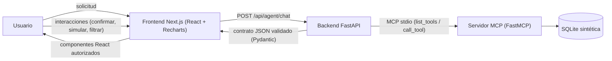

# Banorte AI Finanzas — Prototipo

**Agente financiero con interfaces dinámicas generadas en tiempo real.**

> Prototipo educativo con **datos 100% sintéticos**. No está afiliado a Banorte,
> no solicita credenciales bancarias reales y **nunca mueve dinero real**.

---

## El problema que resuelve

Un chatbot financiero tradicional responde con un muro de texto: la misma pantalla
para cualquier intención y, para actuar, el usuario tiene que irse a otra app.

## La propuesta de valor

Aquí el agente **construye la pantalla que resuelve el problema**: interpreta la
intención, consulta datos con herramientas reales y renderiza componentes
interactivos (gráficos, tablas, simuladores, formularios) que permiten **actuar
dentro de la conversación**. Cada interacción con la UI regresa al agente y
produce nuevas acciones (ciclo cerrado).

**Flujo:** `Usuario → Agente IA → Herramientas → Datos financieros → Interfaz dinámica → Usuario`

## Arquitectura

La documentación vigente del flujo Plan de compra y sus decisiones está en
[docs/ARCHITECTURE.md](docs/ARCHITECTURE.md) y
[docs/DECISIONS.md](docs/DECISIONS.md).



- **Frontend**: Next.js 15 + TypeScript + Tailwind CSS + Recharts.
- **Backend**: FastAPI + Pydantic v2 + SQLite (datos sintéticos persistentes).
- **MCP**: SDK oficial de Python (`mcp`), transporte stdio, 19 herramientas.
- **IA**: proveedor configurable (OpenAI / Anthropic) o **modo demostración**
  sin API key (agente basado en reglas que usa las mismas herramientas MCP reales).

### El ciclo A2UI (interfaz que viaja)

1. El agente detecta la intención (LLM o reglas en modo demo).
2. Invoca herramientas MCP (`list_tools` → `call_tool`) sobre la base sintética.
3. Un **compositor determinista y auditado** genera el JSON de interfaz, validado
   con Pydantic (`extra="forbid"`): el modelo **nunca produce código ejecutable**.
4. El frontend mapea el JSON a componentes React autorizados (registro fijo).
5. Las interacciones (confirmar una meta, cambiar parámetros del simulador,
   clic en una categoría) regresan al backend/agente y generan nuevas respuestas.

## Estructura

```
banorte-ai-finanzas/
├── frontend/          # Next.js 15 + TS + Tailwind + Recharts
├── backend/           # FastAPI + Pydantic + SQLite
│   ├── app/           #   api/ core/ schemas/ services/agent/
│   └── tests/         #   pytest: cálculos, contrato UI, servicios, MCP, seguridad
├── mcp-server/        # Servidor MCP real (FastMCP, stdio)
├── docs/              # Arquitectura y decisiones técnicas
└── scripts/           # start-all.cmd / stop-all.cmd / run-tests.cmd
```

## Instalación desde cero

En Windows necesitas **Python 3.11 o posterior** (con el lanzador `py`) y
**Node.js 18.18 o posterior**. Descárgalos desde
[python.org](https://www.python.org/downloads/windows/) y
[nodejs.org](https://nodejs.org/), respectivamente.

Desde la carpeta raíz del proyecto, ejecuta:

```cmd
scripts\setup.cmd
```

El script verifica las versiones instaladas, crea `.venv`, instala los
requisitos de `backend` y `mcp-server`, ejecuta `npm.cmd install` en
`frontend` y copia `.env.example` a `.env` solo si todavía no existe. Si un
paso falla, muestra el problema y termina con un código de error. Al concluir,
ejecuta `scripts\start-all.cmd` para iniciar la aplicación.

El archivo `.env` inicial mantiene `AI_PROVIDER=demo`, por lo que la
demostración funciona sin una clave ni conexión a un proveedor de IA. Para
configurar un proveedor opcional, edita `.env` localmente; no publiques claves.

## Variables de entorno

| Variable | Descripción |
|---|---|
| `AI_PROVIDER` | `demo` (default, sin API key) · `openai` · `anthropic` |
| `OPENAI_API_KEY` / `OPENAI_MODEL` / `OPENAI_BASE_URL` | Para proveedor OpenAI; modelo predeterminado `gpt-4o-mini` |
| `ANTHROPIC_API_KEY` / `ANTHROPIC_MODEL` | Para proveedor Anthropic; modelo predeterminado `claude-sonnet-4-20250514` |
| `AI_TEMPERATURE` / `AI_TIMEOUT_SECONDS` | Temperatura baja y tiempo límite para llamadas al proveedor |
| `AGENT_MAX_STEPS` / `AGENT_MAX_RETRIES` | Máximo de pasos del agente y reintentos |
| `AGENT_RETRY_DELAY_SECONDS` / `AGENT_TOOL_TIMEOUT_SECONDS` | Espera entre reintentos y tiempo límite de cada herramienta MCP |
| `FRONTEND_ORIGIN` | CORS restrictivo (default `http://localhost:3000`) |
| `DEV_MODE` | `1` habilita `/docs`, `/openapi.json` y detalles técnicos. **Desactivado por defecto**; nunca se activa desde la interfaz pública. |

**No hay secretos en el frontend ni en el código.** Sin API key, la app corre en
modo demostración con el agente por reglas y las mismas herramientas MCP reales.
Desde cero, crea `.env` a partir de `.env.example` solo si necesitas configurar
el proveedor; deja `AI_PROVIDER=demo` para ejecutar completamente en local.

### Asistente accesible y seguro

Al abrir el chat, puedes elegir preguntas listas; después de cada respuesta hay
sugerencias relacionadas. El asistente también puede leer sus respuestas en voz
alta usando la voz del navegador. Su lógica de conversación funciona localmente;
el proveedor de IA es opcional y no se necesita para la demostración. Las
consultas usan los datos sintéticos locales.

El asistente es un prototipo educativo en modo demostración, no es una persona ni
el banco oficial. No puede hacer operaciones reales. No escribas NIP,
contraseñas, códigos, CVV ni números completos de tarjeta o cuenta: el chat los
enmascara en el historial y no los necesita. Si el navegador no ofrece síntesis
de voz, el control para leer en voz alta no aparece.

## Iniciar los servicios

**Un solo script:** `scripts\start-all.cmd` — levanta backend y frontend, espera a
que ambos estén listos, abre el navegador y avisa con un mensaje claro si falta
Python o Node. Para detener todo: `scripts\stop-all.cmd`.

Manual (2 terminales):

```cmd
:: Terminal 1 — Backend (solo localhost)
.venv\Scripts\python -m uvicorn app.main:app --app-dir backend --host 127.0.0.1 --port 8000

:: Terminal 2 — Frontend
cd frontend && npm run dev

:: El servidor MCP se lanza SOLO por el backend (transporte stdio).
:: Para probarlo aislado, ver mcp-server\README.md
```

## Plan de compra

Pregunta, por ejemplo, **"¿Puedo comprar una PC de 45 mil?"**. El asistente
consulta los datos sintéticos locales y presenta opciones de contado, ahorro y
crédito. Al seleccionar una opción, la interfaz vuelve a enviar un evento
tipado al agente y recibe el impacto actualizado. Para crear una meta, la
persona debe revisar el resumen y confirmar en un segundo paso. La meta solo
se guarda en SQLite local y una clave idempotente evita duplicados por reintento
o doble clic; no se mueve dinero real.

## Herramientas MCP (19)

Consulta: `get_balance`, `get_transactions`, `get_cards`, `get_savings_goals`,
`analyze_spending`, `calculate_credit_simulation`, `get_monthly_summary`,
`get_budgets`, `get_spending_trend`, `compare_months`, `get_weekly_spending`,
`detect_recurring_charges`, `detect_anomalies`, `compare_credit_terms`,
`budget_vs_actual`, `project_savings`.

Escritura: `create_savings_goal`*, `update_savings_goal`*,
`apply_savings_contribution`*.

\* Escritura: devuelven `requires_confirmation` sin `confirm=True`; el backend
convierte eso en una acción pendiente que la UI confirma con el usuario. Además,
el backend **fuerza `confirm=False`** en cualquier llamada de escritura que venga
del LLM, de modo que el modelo nunca puede saltarse la confirmación humana.
Los abonos a metas también validan el saldo y lo que falta, guardan el movimiento
sintético y son idempotentes ante reintentos o doble clic.

## Pruebas

```cmd
.venv\Scripts\python -m pytest backend\tests -v
cd frontend && npm test
cd frontend && npm run build
```

La suite cubre matemática financiera, contrato versionado, proveedor/fallback,
límite y reintentos, ciclo de eventos del Plan de compra, confirmación e
idempotencia MCP, inyección, enmascaramiento de datos, logs estructurados,
integración por stdio y pruebas de frontend. El build comprueba compilación y
tipos de TypeScript.

## Seguridad y privacidad

- Solo datos sintéticos; sin credenciales bancarias, CVV ni números completos.
- SQL 100% parameterizado; CORS restringido al origen del frontend.
- Contrato UI con Pydantic `extra="forbid"`; el frontend solo renderiza tipos
  autorizados desde un registro fijo (nunca evalúa el JSON como código).
- Escrituras con confirmación explícita del usuario y rechazo de duplicados.
- **Sin fugas técnicas en la interfaz:** ni la UI ni las respuestas muestran
  nombres de herramientas, protocolos ni arquitectura (verificado con pruebas).
- **Guardas anti-manipulación:** 40 variantes de ataque probadas obtienen una
  negativa amable; el texto malicioso dentro de datos se neutraliza.
- `/docs` y `/openapi.json` deshabilitados salvo `DEV_MODE=1`; errores genéricos
  al usuario ("No pude hacer eso. ¿Lo intentamos de otra forma?") y detalle solo
  en el log; sin encabezados de versión del servidor; límite de 30 mensajes/10 s.
- El simulador de crédito es **educativo**: no es una oferta, tasa ni aprobación real.

## Accesibilidad (WCAG 2.2 AA)

- Letra base de 18 px con control A- / A / A+ persistente.
- Contraste ≥ 4.5:1 en texto y ≥ 3:1 en gráficos (paleta oscura verificada).
- Las rebanadas del pastel muestran nombre + porcentaje, con leyenda textual con
  valores; toda gráfica tiene resumen en palabras (`aria-label`) y vista "Ver
  como tabla".
- Botones de mínimo 44–48 px, foco visible, navegación por teclado.
- Respeta "reducir movimiento" del sistema.
- Glosario "¿Qué significa?" (CAT, plazo, tasa, pago mínimo) en el simulador.

## Guion de demostración (3–5 min)

1. Abre `http://localhost:3000` → dashboard con KPIs, gráficas, metas.
2. En **Asistente IA**: *"¿Cómo han cambiado mis gastos en los últimos 4 meses?"*
   → gráfica de líneas de 4 meses con valores y conclusión (sin pastel ni
   recomendaciones no pedidas).
3. *"Analiza mis gastos de este mes"* → pastel con etiquetas y valores; alterna
   "Ver como tabla". "ahora en barras" cambia el tipo.
4. *"Ayúdame a ahorrar $5,000"* → formulario + confirmación con resumen; al
   confirmar se persiste y aparece en Ahorro y metas.
5. *"¿Cuánto podría pagar mensualmente por un crédito?"* → simulador vivo con
   glosario "¿Qué significa?" y aviso de que no es oferta.
6. *"¿Qué cargos fijos tengo?"* / *"¿tengo cargos duplicados?"* → listas de
   cargos recurrentes y alertas.
7. La conversación sobrevive a cambiar de pantalla y a recargar (historial en la
   barra lateral, con nueva conversación y borrado con confirmación).

## Mejoras futuras

- Autenticación real (OAuth) y multiusuario.
- Streaming de respuestas del agente (SSE).
- Aprobaciones de escritura persistentes (tabla `pending_actions`).
- Resumen semanal proactivo y alertas de gasto por categoría.
- CAT y comisiones en el simulador; perfilamiento de inversión.

## Problemas conocidos y limitaciones (modo demostración)

- La comprensión del lenguaje natural es por **reglas**: cubre los casos probados
  (ortografía común, coloquialismos, cantidades en palabras, fechas relativas),
  pero frases muy libres pueden requerir `AI_PROVIDER=anthropic|openai`.
- Los datos son ficticios por diseño; el prototipo **no** se conecta a bancos.
- Los pagos, transferencias, contactos, inversiones y seguros son secciones
  simuladas informativas (no mueven dinero ni guardan instrumentos reales).
- El límite de peticiones (30/10 s) es en memoria: se reinicia al reiniciar el
  backend; para producción usar Redis o similar.
- Las conversaciones se guardan en `localStorage` del navegador (por equipo y
  navegador); no hay sincronización multi-dispositivo ni servidor de historial.
