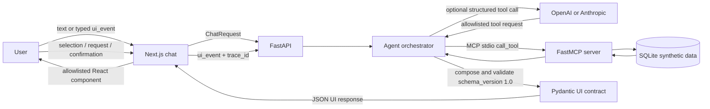

# Purchase Plan Architecture

## Scope and safety

This is an educational prototype backed by synthetic SQLite data. It is not the
official bank, does not provide personalized financial advice, and cannot move
real money. Creating a savings goal changes only the local demonstration data.

The LLM is an optional intent and tool-selection layer. The default `demo`
provider works without an API key or internet. Refusals and sensitive-data
handling remain local. A provider failure falls back to the deterministic
agent when local MCP tools are available.

## Components and data flow

### Purchase-plan sequence

1. The backend normalizes the request and extracts an amount from common forms
   such as `45mil`, `45 mil`, and `$45,000`. Missing or out-of-range amounts
   receive a local clarification or validation response.
2. The orchestrator fetches balance, monthly summary, fixed payments, and
   credit simulations through allowlisted MCP tools. It caps tool steps and
   call duration, retries eligible failures with backoff, and records safe
   trace events.
3. Deterministic composer code builds `purchase_plan`: cash, a 12-month savings
   goal, and 12/18/24-month credit options. Pydantic validates the complete
   versioned response before it leaves the backend.
4. A selected option is sent back as a typed `ui_event`. The server correlates
   it to the plan's stored trace and returns an updated plan with the estimated
   monthly-balance impact.
5. Creating a goal takes two separate events: request preparation, then an
   explicit confirmation. The server checks the selected savings option,
   confirmation token, and idempotency key before calling the MCP write tool.
   SQLite stores the result under that key in the same transaction as the
   goal, so a retry or double click replays the original result instead of
   creating a duplicate. The response includes the updated savings screen.

Plan state and event replay data are held in bounded, expiring backend memory;
they are not durable across backend restarts. The created goal and its
idempotency record are persisted in SQLite.

## Contracts and trust boundaries

- `backend/app/schemas/ui.py` is the Pydantic source contract. Responses carry
  `schema_version: "1.0"` and reject unknown fields.
- `frontend/src/types/contract.ts` mirrors the UI types. The fixed renderer
  registry refuses unknown component types; it never evaluates response data
  as code.
- `backend/app/schemas/api.py` validates event type and payload combinations.
  The orchestrator additionally verifies the event against server-held plan
  state; a client-supplied token alone cannot authorize a write.
- Only names in `MCP_ALLOWED_TOOLS` can be called by the agent. LLM requests
  cannot execute writes directly; write tool calls from that path are forced
  to `confirm=False`.
- Sensitive text is masked before conversation persistence or forwarding to a
  provider. Logs use JSON with an explicit field allowlist and do not record
  user message content or arbitrary exception text.

## Runtime limits and fallback

The tool loop is bounded by `AGENT_MAX_STEPS`, `AGENT_TOOL_TIMEOUT_SECONDS`,
`AGENT_MAX_RETRIES`, and `AGENT_RETRY_DELAY_SECONDS`. LLM requests use
`AI_TIMEOUT_SECONDS` and low `AI_TEMPERATURE`. An invalid structured provider
turn is retried once; failure switches to deterministic local behavior.

The MCP server is a child process using the official Python MCP SDK over stdio.
It reuses the backend finance services and SQLite database rather than
duplicating finance logic. When no provider key exists, the deterministic
orchestrator uses the same local MCP tools and UI contract.
