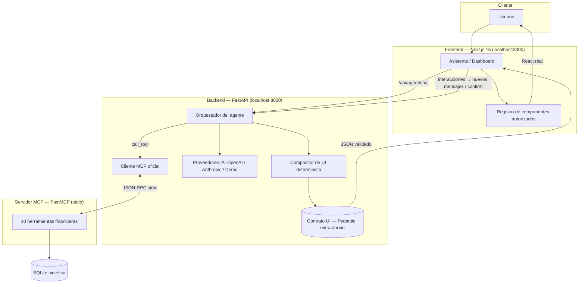

# Arquitectura y decisiones técnicas — Banorte AI Finanzas

## Diagrama de arquitectura

## Decisiones técnicas y trade-offs

### 1. Contrato de interfaz tipo A2UI con validación estricta
El agente no genera HTML/JS; genera un **selector de componentes** + props desde
un catálogo cerrado de 8 tipos. Pydantic valida con `extra="forbid"` (rechaza
cualquier campo no esperado, p. ej. un `onClick` inyectado) y el frontend repite
la validación de tipo con un registro fijo. **Trade-off:** la UI es menos
"libre" que HTML generado por LLM, pero es segura, accesible, consistente y
testeable.

### 2. Compositor determinista
Aunque el LLM elija herramientas y redacte el mensaje, **el JSON de UI lo arma
código auditado** con los resultados de las herramientas. En modo demo, reglas
deterministas reemplazan al LLM sin cambiar nada más. Así el contrato nunca
depende del comportamiento del modelo.

### 3. MCP real, no simulado
El backend lanza `mcp-server/server.py` como subproceso y habla JSON-RPC stdio
con el SDK oficial `mcp`: `initialize` → `list_tools` (descubrimiento real) →
`call_tool`. Las mismas herramientas quedan disponibles para cualquier cliente
MCP (p. ej. Claude Desktop). **Trade-off:** un proceso más que orquestar, a
cambio de interoperabilidad y de separar "cerebro" de "datos".

### 4. Capa de datos compartida (backend ↔ MCP)
`mcp-server` importa `backend/app/services` vía `sys.path` para no duplicar la
lógica de datos. Documentado como trade-off de prototipo; la alternativa es un
paquete instalable compartido.

### 5. Confirmación humana en escrituras
`create_savings_goal` / `update_savings_goal` exigen `confirm=True`. Sin él,
devuelven `requires_confirmation`; el backend lo transforma en una acción
pendiente para la UI. El orquestador **sobrescribe** `confirm=False` cuando quien
llama es el LLM: el modelo no puede autorizar escrituras.

### 6. Modo demostración explícito
Sin API key el agente funciona por reglas sobre las **mismas herramientas MCP
reales**, y cada respuesta se etiqueta "Modo demostración". Nunca se finge que
hay un modelo conectado.

### 7. Stack frontend
Next.js 15 + TypeScript estricto, Tailwind (identidad roja/blanca/gris, sin
logotipos oficiales), Recharts para visualizaciones. Accesibilidad: labels en
controles, foco visible, navegación por teclado.

### 8. Seguridad
SQL parameterizado, CORS restringido, Pydantic en todas las entradas API,
sin secretos en el cliente, sin datos bancarios reales, simulador educativo con
disclaimer permanente.
