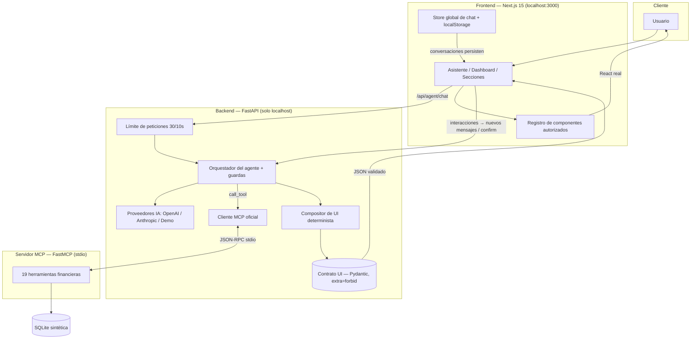

# Arquitectura y decisiones técnicas — Banorte AI Finanzas

El flujo versionado de Plan de compra y las decisiones de proveedor, A2UI,
MCP/stdio, SQLite y fallback están detallados en
[ARCHITECTURE.md](./ARCHITECTURE.md) y [DECISIONS.md](./DECISIONS.md).

## Diagrama de arquitectura

## Decisiones técnicas y trade-offs

### 1. Contrato de interfaz tipo A2UI con validación estricta
El agente no genera HTML/JS; genera un **selector de componentes** + props desde
un catálogo cerrado de 13 tipos, incluido `purchase_plan`. Pydantic valida con
`schema_version: "1.0"` y `extra="forbid"` (rechaza
cualquier campo no esperado, p. ej. un `onClick` inyectado) y el frontend repite
la validación de tipo con un registro fijo. **Trade-off:** la UI es menos
"libre" que HTML generado por LLM, pero es segura, accesible, consistente y
testeable.

### 2. Compositor determinista
Aunque el LLM elija herramientas y redacte el mensaje, **el JSON de UI lo arma
código auditado** con los resultados de las herramientas. En modo demo, reglas
deterministas reemplazan al LLM sin cambiar nada más. Así el contrato nunca
depende del comportamiento del modelo. Los mensajes del compositor usan
exclusivamente lenguaje de negocio: ninguna herramienta, protocolo o detalle de
arquitectura llega a la UI (regresión: `test_bugfixes.py::TestBug003NoInfoLeak`).

### 3. MCP real, no simulado
El backend lanza `mcp-server/server.py` como subproceso y habla JSON-RPC stdio
con el SDK oficial `mcp`: `initialize` → `list_tools` (descubrimiento real) →
`call_tool`. Las mismas herramientas quedan disponibles para cualquier cliente
MCP. **Trade-off:** un proceso más que orquestar, a cambio de interoperabilidad
y de separar "cerebro" de "datos".

### 4. Capa de datos compartida (backend ↔ MCP)
`mcp-server` importa `backend/app/services` vía `sys.path` para no duplicar la
lógica de datos. Dashboard, secciones, gráficas y chat leen la misma SQLite:
**una sola fuente de verdad** (regresión: `TestBug008RealisticSeed`).

### 5. Confirmación humana en escrituras
`create_savings_goal` / `update_savings_goal` / `apply_savings_contribution`
exigen `confirm=True`. Sin él,
devuelven `requires_confirmation`; el backend lo transforma en una acción
pendiente para la UI. El orquestador **sobrescribe** `confirm=False` cuando quien
llama es el LLM: el modelo no puede autorizar escrituras. Validaciones del
servicio/API: duplicados rechazados (409), montos 0/negativos/absurdos
(≤ $10,000,000), fechas pasadas, nombres con HTML/script sanitizados.

El abono valida la meta, el monto pendiente y el saldo disponible dentro de una
transacción SQLite; actualiza el progreso, descuenta saldo sintético, registra
el movimiento y escribe el resultado idempotente. La confirmación UI se verifica
con tokens conservados por el servidor.

### 6. Modo demostración y lenguaje natural por reglas
Sin API key el agente funciona por reglas sobre las **mismas herramientas MCP
reales**. La capa de normalización (`normalize`) maneja acentos, abreviaturas
("q", "ke"), coloquialismos ("lana", "varo"), cantidades en palabras ("cinco
mil", "5k", "5 mil") y sinónimos de categorías. El contexto conversacional
(`_followup`) resuelve "y el mes pasado?", "ahora en barras", "solo lo de
comida" y correcciones "no, me refería a…". Con `AI_PROVIDER=anthropic|openai`
el mismo orquestador usa el LLM con las mismas guardas.

### 7. Guardas de seguridad del agente
- Detección de inyección por patrones (40 variantes probadas) → respuesta fija
  amable, nunca generada por el modelo.
- Preguntas de identidad → mensaje fijo. Fuera de alcance (clima, política,
  salud, chistes, bolsa) → negativa cortés que explica qué sí puede hacer.
- El patrón de inyección también aplica en modo LLM, delante del modelo.
- La superficie técnica está oculta: `/docs`, `/openapi.json` solo con
  `DEV_MODE=1`; `/api/health` no lista herramientas; errores 500 genéricos con
  detalle solo en log; sin encabezado `Server`; CORS a un solo origen; backend
  enlazado a `127.0.0.1`.

### 8. Persistencia de conversación (frontend)
El estado del chat vive en un store global fuera de React
(`lib/chatStore.ts`, `useSyncExternalStore`) montado desde el layout de la
página: sobrevive a la navegación entre secciones y se persiste en
`localStorage` (sobrevive a recargas). La barra lateral gestiona el historial:
título automático (primer mensaje), fecha, nueva conversación y borrado con
confirmación. **Trade-off:** sin sincronización multi-dispositivo (no hay
backend de historial en el prototipo).

### 9. Resultado único + panel de detalle (BUG-005)
Cada resultado se renderiza **una sola vez, dentro del chat** (mejor para
personas mayores: el resultado queda junto a la pregunta). El panel derecho es
"Detalle expandido", opcional y solo con el resultado que el usuario abra.

### 10. Stack frontend y accesibilidad
Next.js 15 + TypeScript estricto, Tailwind (identidad roja/blanca/gris, sin
logotipos oficiales), Recharts. WCAG 2.2 AA: base de 18 px con control A-/A/A+,
paleta de gráficas con contraste ≥ 3:1, etiquetas + valores sobre cada dato,
vista tabla en toda gráfica, `aria-label` descriptivos, botones ≥ 44 px, foco
visible y `prefers-reduced-motion` respetado.

### 11. Formato y dinero
`lib/format.ts` centraliza moneda MXN con 2 decimales (`Intl.NumberFormat`) y
fechas mexicanas ("18 de octubre de 2026"). En el backend, el cálculo de crédito
trabaja con redondeos a 2 decimales en cada periodo y la suma del calendario
coincide con el total (regresión: `TestBug012Formatting`).

### 12. Robustez operativa
Límite de peticiones en el endpoint de chat (30 mensajes / 10 s, mensaje
amable); mensajes de hasta 5,000 caracteres; `AbortController` para cancelar
consultas y evitar doble envío; estados de carga, vacío y error con
"Reintentar"; scripts `start-all.cmd` (espera health-checks y abre el
navegador) y `stop-all.cmd`.
