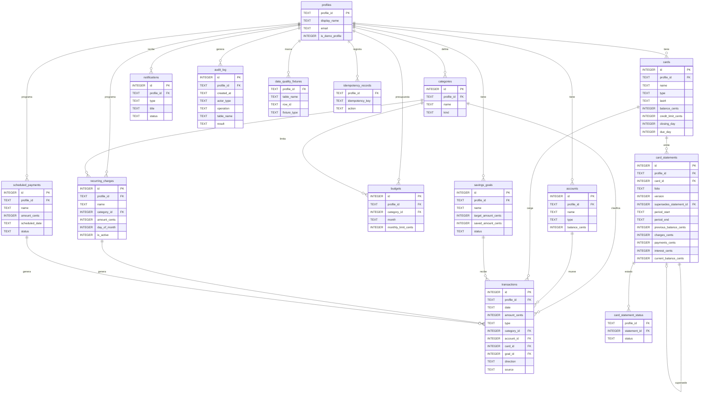

# DATA-DICTIONARY — Diseño de esquema D1 (revisión corregida)

**Estado:** propuesta de diseño. **D1 no está aprobado.** No se modificó la base de datos ni se inició D2.
**Alcance:** perfiles demo, cuentas, tarjetas, estados de cuenta, categorías, presupuestos, metas, recurrentes, notificaciones, auditoría, 24 meses de historia.
**Fuera de alcance (D6 opcional):** inversiones, seguros, préstamos, tipo de cambio.

**Regla de este documento:** separar siempre tres cosas:

1. **Esquema que produce el código hoy** (`backend/app/core/seed.py`, versión `ledger-v2`).
2. **Estado real de `backend/data/banorte.db`**, medido sobre una copia con `PRAGMA table_info`.
3. **Esquema D1 propuesto** (este documento). Nada de lo marcado como “D1” está aplicado todavía.

---

## 0. Corrección de integridad del documento

La versión anterior de este archivo estaba corrupta: el bloque Mermaid no cerraba, aparecían líneas del diagrama entre tablas, `audit_log` estaba cortado y su detalle quedó al final, y los bloques de la sección 5 se cerraron mal.

Esta versión se reescribió completa y aplica estas reglas de integridad:

- Todos los bloques de código están abiertos y cerrados con triple backtick.
- El diagrama Mermaid está aislado en su propia sección, sin filas de tablas dentro.
- `audit_log` está definido una sola vez y completo en §4 y §5.
- La sección de verificación (§13) tiene sus bloques bien cerrados.
- La matriz final (§14) cubre los 13 puntos solicitados.

La validación de Mermaid se documenta en §13.

---

## 1. Estado verificado: código vs base real

### 1.1 Esquema que produce el código hoy

El DDL canónico vigente vive en `backend/app/core/seed.py` (`TABLE_DDL`, `TRANSACTIONS_DDL`, `TRANSACTIONS_INDEXES`, `TRIGGERS`). El código espera la versión `ledger-v2` (`backend/app/core/migrate.py:43`).

Tablas actuales:

| Tabla | Columnas de dinero | Tipo de dinero | Notas |
|---|---|---|---|
| `accounts` | `balance_cents` | `INTEGER` | Sin `profile_id`; sin apertura explícita. |
| `cards` | `balance_cents`, `credit_limit_cents` | `INTEGER` | Sin `profile_id`; sin pago mínimo; `closing_day`/`due_day` nullable. |
| `savings_goals` | `target_amount_cents`, `saved_amount_cents` | `INTEGER` | Sin `profile_id`; `saved_amount_cents` se escribe en la semilla. |
| `transactions` | `amount_cents` | `INTEGER` | Tipos `income`, `expense`, `transfer`; sin `opening`, sin `card_id`, sin `profile_id`. |
| `budgets` | `monthly_limit_cents` | `INTEGER` | Una fila por categoría de texto; sin mes; sin `spent_cents`. |
| `idempotency_records` | — | — | Clave global; sin `profile_id`. |
| `schema_migrations` | — | — | Ya existe en el código (`migrate.REGISTRY_DDL`). |

Conclusión del código:

- El dinero **sí** está en centavos enteros en el esquema que produce el código.
- **No** existen todavía: `profiles`, `categories`, `card_statements`, `audit_log`, `notifications`, `recurring_charges`, `scheduled_payments`, `data_quality_fixtures`, `budget_history`, `goal_contribution_history`, `account_balance_history`.
- **No** existen FKs compuestas por `profile_id`, ni `card_id` en `transactions`, ni el tipo `opening`.

### 1.2 Estado real de `banorte.db` (medido sobre una copia)

Se copió `backend/data/banorte.db` a `C:\Users\jonna\AppData\Local\Temp\opencode\banorte_d1_inspect.db` y se ejecutaron `PRAGMA table_info`, `PRAGMA index_list`, `PRAGMA foreign_key_list`, `PRAGMA foreign_key_check` y una lectura de `schema_migrations` **sobre la copia**. La base original no se abrió para escritura.

Evidencia observada:

| Comprobación | Resultado |
|---|---|
| Hash SHA-256 de la base original al copiarla | `48AED47499A0141ABAD80308AAE9B0CF506E37F6C05C49C77F77B5393AC287BB` |
| Tablas | `accounts`, `budgets`, `cards`, `idempotency_records`, `savings_goals`, `schema_migrations`, `transactions` |
| `schema_migrations` | `ledger-v1` y `ledger-v2`, ambas con `applied_at = 2026-10-30 00:52:54` |
| Respaldo registrado | `banorte.db.bak-20261029-185254` |
| `transactions.amount_cents` | `INTEGER` |
| `accounts.balance_cents` | `INTEGER` |
| `cards.balance_cents` / `credit_limit_cents` | `INTEGER` |
| `savings_goals.target_amount_cents` / `saved_amount_cents` | `INTEGER` |
| `budgets.monthly_limit_cents` | `INTEGER` |
| Columnas `REAL` en tablas de dinero | Ninguna |
| `PRAGMA foreign_key_check` | 0 filas |
| Triggers | `trg_goal_saved_bounds_ins`, `trg_goal_saved_bounds_upd`, `trg_transfer_within_goal_bounds`, `trg_account_balance_non_negative` |
| Índices de `transactions` | `idx_tx_date(date)`, `idx_tx_category(category)` |
| FKs de `transactions` | `account_id → accounts(id)`, `goal_id → savings_goals(id)` (simples, sin `profile_id`) |

**¿Terminó la migración de la base real?** Sí, para la cadena existente: `ledger-v1` y `ledger-v2` están registradas y el esquema real está en centavos enteros. **No** está aplicado el esquema D1 de este documento. La base real sigue siendo el esquema de 7 tablas descrito en §1.1.

### 1.3 Brechas reales frente a D1

| Brecha | Estado real hoy |
|---|---|
| Aislamiento por perfil | No existe `profiles` ni `profile_id` en tablas de dominio. |
| FKs compuestas | No existen; solo FKs simples en `transactions`. |
| Movimiento de apertura | No existe tipo `opening`; la semilla usa saldos estáticos y una transferencia de fondeo. |
| Tarjetas en el libro | No existe `card_id` en `transactions`; el “Pago tarjeta de crédito” de la semilla es un `expense` de categoría `Tarjetas`. |
| Categorías normalizadas | `transactions.category` y `budgets.category` son texto libre. |
| Presupuesto histórico | `budgets` no tiene mes ni historial; no hay vistas. |
| Estados de cuenta | No existe `card_statements`. |
| Auditoría | No existe `audit_log`. |
| Booleanos y fechas | No hay convención uniforme de `INTEGER 0/1` ni `CHECK` ISO en todas las tablas. |
| Conexiones con FK activas | Solo `database.connect()` y `migrate._connect()` ejecutan `PRAGMA foreign_keys = ON`; hay conexiones directas en pruebas/scripts que no lo hacen. |

---

## 2. Convenciones del esquema D1

Estas convenciones aplican a **todas** las tablas nuevas y a las ampliadas.

| Convención | Regla |
|---|---|
| Dinero | Toda columna de dinero es `INTEGER` en centavos y termina en `_cents`. Prohibido `REAL`, `FLOAT`, `DOUBLE` o `NUMERIC` para dinero. |
| Porcentajes | Se guardan como enteros en **puntos base** (`*_bp`), donde `10000 bp = 100 %`. Si no se guardan, se calculan en una vista con aritmética entera. Prohibido `REAL`. |
| Booleanos | `INTEGER NOT NULL CHECK (col IN (0,1))`. |
| Fechas | `TEXT` ISO `YYYY-MM-DD` con `CHECK (col = strftime('%Y-%m-%d', col))`. |
| Fechas-hora | `TEXT` ISO con `CHECK (datetime(col) IS NOT NULL)`. |
| Listas cerradas | `CHECK (col IN (...))` para `type`, `status`, `source`, `direction`, `actor_type`, `operation`, `result`, `channel`, `kind`, etc. |
| Perfil | Toda tabla de dominio tiene `profile_id TEXT NOT NULL` y FK a `profiles(profile_id)`. |
| Claves foráneas | Compuestas y explícitas: `FOREIGN KEY (profile_id, x_id) REFERENCES padre(profile_id, id)`. Cada tabla padre declara `UNIQUE (profile_id, id)`. |
| Conexiones | `PRAGMA foreign_keys = ON` en **toda** conexión, mediante una fábrica única de conexiones. No se acepta una convención de acceso a datos. |
| Derivados | Lo derivado del libro se expone como vista, no como tabla duplicada. Las cachés permitidas se reconcilian y se prueban. |
| Nombres | Tablas en plural, columnas en `snake_case`, claves `id`/`*_id`, importes `*_cents`, porcentajes `*_bp`. |

---

## 3. Diagrama entidad-relación (Mermaid)

El siguiente diagrama muestra solo **tablas base** (las vistas se explican en §6).



### 3.1 Flujo del libro con tarjetas

```mermaid
flowchart LR
    OP["Apertura<br/>type=opening"] -->|"+ amount"| AC["Saldo de cuenta"]
    IN["Ingreso<br/>type=income"] -->|"+ amount"| AC
    EX["Gasto con cuenta<br/>type=expense"] -->|"- amount"| AC
    CC["Cargo de tarjeta<br/>type=expense + card_id"] -->|"+ amount"| CD["Deuda de tarjeta"]
    PC["Pago de tarjeta<br/>type=transfer account_to_card"] -->|"- amount"| AC
    PC -->|"- amount"| CD
    TG["Transferencia a meta<br/>type=transfer account_to_goal"] -->|"- amount"| AC
    TG -->|"+ amount"| GO["Ahorro en meta"]
    WG["Retiro de meta<br/>type=transfer goal_to_account"] -->|"+ amount"| AC
    WG -->|"- amount"| GO
    AC --> NW["Patrimonio<br/>= cuentas + metas - deuda"]
    GO --> NW
    CD -->|"- deuda"| NW
```



---

## 4. DDL canónico propuesto (SQLite)

**Orden de creación:** `profiles` → `categories` → `accounts` → `cards` → `savings_goals` → `recurring_charges` → `scheduled_payments` → `transactions` → `budgets` → `card_statements` → `card_statement_status` → `notifications` → `audit_log` → `data_quality_fixtures` → `idempotency_records` → `schema_migrations`.

> Este DDL es **propuesta de D1**. No se ejecutó ni se aplicó a `banorte.db`.

### 4.1 `schema_migrations`

Ya existe en el código (`backend/app/core/migrate.py`) y en la base real. Se documenta para que el diccionario sea completo.

```sql
CREATE TABLE IF NOT EXISTS schema_migrations (
    version     TEXT PRIMARY KEY,
    applied_at  TEXT NOT NULL DEFAULT (strftime('%Y-%m-%dT%H:%M:%fZ','now'))
                CHECK (datetime(applied_at) IS NOT NULL),
    checksum    TEXT NOT NULL,
    result_json TEXT NOT NULL CHECK (json_valid(result_json)),
    backup_file TEXT
);
```

### 4.2 `profiles`

```sql
CREATE TABLE profiles (
    profile_id TEXT PRIMARY KEY,
    display_name TEXT NOT NULL,
    email TEXT NOT NULL UNIQUE,
    language TEXT NOT NULL DEFAULT 'es-MX' CHECK (language IN ('es-MX','en-US')),
    accessibility_profile TEXT NOT NULL DEFAULT 'standard'
        CHECK (accessibility_profile IN ('standard','large_text','high_contrast')),
    contact_channels TEXT NOT NULL DEFAULT 'none'
        CHECK (contact_channels IN ('none','email','push','email_push')),
    digital_experience_level TEXT NOT NULL DEFAULT 'intermedio'
        CHECK (digital_experience_level IN ('basico','intermedio','avanzado')),
    is_demo_profile INTEGER NOT NULL DEFAULT 1 CHECK (is_demo_profile IN (0,1)),
    created_at TEXT NOT NULL DEFAULT (strftime('%Y-%m-%dT%H:%M:%fZ','now'))
        CHECK (datetime(created_at) IS NOT NULL),
    CHECK (lower(email) LIKE '%@example.test')
);
```

### 4.3 `categories`

```sql
CREATE TABLE categories (
    id INTEGER PRIMARY KEY AUTOINCREMENT,
    profile_id TEXT NOT NULL,
    name TEXT NOT NULL,
    kind TEXT NOT NULL CHECK (kind IN ('income','expense')),
    is_active INTEGER NOT NULL DEFAULT 1 CHECK (is_active IN (0,1)),
    created_at TEXT NOT NULL DEFAULT (strftime('%Y-%m-%dT%H:%M:%fZ','now'))
        CHECK (datetime(created_at) IS NOT NULL),
    UNIQUE (profile_id, name),
    UNIQUE (profile_id, id),
    FOREIGN KEY (profile_id) REFERENCES profiles(profile_id)
);
```

### 4.4 `accounts`

Sin `opening_transaction_id`. La apertura vive en `transactions` como `type='opening'` y se garantiza con un índice único parcial (§9). Así se elimina el ciclo `accounts.opening_transaction_id ↔ transactions`.

```sql
CREATE TABLE accounts (
    id INTEGER PRIMARY KEY AUTOINCREMENT,
    profile_id TEXT NOT NULL,
    name TEXT NOT NULL,
    type TEXT NOT NULL CHECK (type IN ('debit','savings','cash')),
    currency TEXT NOT NULL DEFAULT 'MXN' CHECK (currency = 'MXN'),
    balance_cents INTEGER NOT NULL DEFAULT 0 CHECK (balance_cents >= 0),
    is_active INTEGER NOT NULL DEFAULT 1 CHECK (is_active IN (0,1)),
    created_at TEXT NOT NULL DEFAULT (strftime('%Y-%m-%dT%H:%M:%fZ','now'))
        CHECK (datetime(created_at) IS NOT NULL),
    UNIQUE (profile_id, id),
    FOREIGN KEY (profile_id) REFERENCES profiles(profile_id)
);
```

### 4.5 `cards`

`balance_cents` representa **deuda** para tarjetas de crédito. `minimum_payment_bp` está en puntos base (500 = 5 %).

```sql
CREATE TABLE cards (
    id INTEGER PRIMARY KEY AUTOINCREMENT,
    profile_id TEXT NOT NULL,
    name TEXT NOT NULL,
    type TEXT NOT NULL CHECK (type IN ('credit','debit')),
    last4 TEXT NOT NULL CHECK (
        length(last4) = 4 AND last4 GLOB '[0-9][0-9][0-9][0-9]'
    ),
    balance_cents INTEGER NOT NULL DEFAULT 0 CHECK (balance_cents >= 0),
    credit_limit_cents INTEGER NOT NULL DEFAULT 0 CHECK (credit_limit_cents >= 0),
    closing_day INTEGER NOT NULL CHECK (closing_day BETWEEN 1 AND 28),
    due_day INTEGER NOT NULL CHECK (due_day BETWEEN 1 AND 28),
    minimum_payment_bp INTEGER NOT NULL DEFAULT 500
        CHECK (minimum_payment_bp BETWEEN 0 AND 10000),
    is_active INTEGER NOT NULL DEFAULT 1 CHECK (is_active IN (0,1)),
    created_at TEXT NOT NULL DEFAULT (strftime('%Y-%m-%dT%H:%M:%fZ','now'))
        CHECK (datetime(created_at) IS NOT NULL),
    UNIQUE (profile_id, id),
    FOREIGN KEY (profile_id) REFERENCES profiles(profile_id),
    CHECK (type = 'credit' OR (balance_cents = 0 AND credit_limit_cents = 0))
);
```

### 4.6 `savings_goals`

`saved_amount_cents` es una **caché derivada** de las transferencias. La fuente de verdad es `transactions`; la reconciliación está en §6.

```sql
CREATE TABLE savings_goals (
    id INTEGER PRIMARY KEY AUTOINCREMENT,
    profile_id TEXT NOT NULL,
    name TEXT NOT NULL,
    target_amount_cents INTEGER NOT NULL CHECK (target_amount_cents > 0),
    saved_amount_cents INTEGER NOT NULL DEFAULT 0 CHECK (saved_amount_cents >= 0),
    deadline TEXT CHECK (
        deadline IS NULL OR deadline = strftime('%Y-%m-%d', deadline)
    ),
    status TEXT NOT NULL DEFAULT 'activa'
        CHECK (status IN ('activa','completada','cancelada')),
    created_at TEXT NOT NULL DEFAULT (strftime('%Y-%m-%dT%H:%M:%fZ','now'))
        CHECK (datetime(created_at) IS NOT NULL),
    UNIQUE (profile_id, name),
    UNIQUE (profile_id, id),
    FOREIGN KEY (profile_id) REFERENCES profiles(profile_id),
    CHECK (saved_amount_cents <= target_amount_cents)
);
```

### 4.7 `recurring_charges`

```sql
CREATE TABLE recurring_charges (
    id INTEGER PRIMARY KEY AUTOINCREMENT,
    profile_id TEXT NOT NULL,
    name TEXT NOT NULL,
    category_id INTEGER NOT NULL,
    amount_cents INTEGER NOT NULL CHECK (amount_cents > 0),
    day_of_month INTEGER NOT NULL CHECK (day_of_month BETWEEN 1 AND 28),
    is_active INTEGER NOT NULL DEFAULT 1 CHECK (is_active IN (0,1)),
    starts_on TEXT NOT NULL CHECK (starts_on = strftime('%Y-%m-%d', starts_on)),
    ends_on TEXT CHECK (
        ends_on IS NULL OR ends_on = strftime('%Y-%m-%d', ends_on)
    ),
    created_at TEXT NOT NULL DEFAULT (strftime('%Y-%m-%dT%H:%M:%fZ','now'))
        CHECK (datetime(created_at) IS NOT NULL),
    UNIQUE (profile_id, id),
    FOREIGN KEY (profile_id) REFERENCES profiles(profile_id),
    FOREIGN KEY (profile_id, category_id) REFERENCES categories(profile_id, id),
    CHECK (ends_on IS NULL OR ends_on >= starts_on)
);
```

### 4.8 `scheduled_payments`

```sql
CREATE TABLE scheduled_payments (
    id INTEGER PRIMARY KEY AUTOINCREMENT,
    profile_id TEXT NOT NULL,
    name TEXT NOT NULL,
    amount_cents INTEGER NOT NULL CHECK (amount_cents > 0),
    scheduled_date TEXT NOT NULL
        CHECK (scheduled_date = strftime('%Y-%m-%d', scheduled_date)),
    status TEXT NOT NULL DEFAULT 'pendiente'
        CHECK (status IN ('pendiente','ejecutado','cancelado')),
    created_at TEXT NOT NULL DEFAULT (strftime('%Y-%m-%dT%H:%M:%fZ','now'))
        CHECK (datetime(created_at) IS NOT NULL),
    UNIQUE (profile_id, id),
    FOREIGN KEY (profile_id) REFERENCES profiles(profile_id)
);
```

### 4.9 `transactions` (libro único)

Tipos cerrados: `income`, `expense`, `transfer`, `opening`.

- `income`: categoría de ingreso + cuenta.
- `expense`: categoría de gasto + **exactamente una** de cuenta o tarjeta.
- `transfer`: sin categoría; `account_id` obligatorio; `direction` decide meta o tarjeta.
- `opening`: sin categoría; cuenta obligatoria; **no es ingreso**.

```sql
CREATE TABLE transactions (
    id INTEGER PRIMARY KEY AUTOINCREMENT,
    profile_id TEXT NOT NULL,
    date TEXT NOT NULL CHECK (date = strftime('%Y-%m-%d', date)),
    description TEXT NOT NULL,
    amount_cents INTEGER NOT NULL CHECK (amount_cents > 0),
    type TEXT NOT NULL CHECK (type IN ('income','expense','transfer','opening')),
    category_id INTEGER,
    account_id INTEGER,
    card_id INTEGER,
    goal_id INTEGER,
    direction TEXT CHECK (
        direction IS NULL OR direction IN (
            'account_to_goal','goal_to_account','account_to_card'
        )
    ),
    source TEXT NOT NULL DEFAULT 'manual' CHECK (
        source IN ('manual','recurring','scheduled','opening','card_statement','seed','agent')
    ),
    recurring_charge_id INTEGER,
    scheduled_payment_id INTEGER,
    is_interest INTEGER NOT NULL DEFAULT 0 CHECK (is_interest IN (0,1)),
    created_at TEXT NOT NULL DEFAULT (strftime('%Y-%m-%dT%H:%M:%fZ','now'))
        CHECK (datetime(created_at) IS NOT NULL),
    UNIQUE (profile_id, id),
    FOREIGN KEY (profile_id) REFERENCES profiles(profile_id),
    FOREIGN KEY (profile_id, category_id) REFERENCES categories(profile_id, id),
    FOREIGN KEY (profile_id, account_id) REFERENCES accounts(profile_id, id),
    FOREIGN KEY (profile_id, card_id) REFERENCES cards(profile_id, id),
    FOREIGN KEY (profile_id, goal_id) REFERENCES savings_goals(profile_id, id),
    FOREIGN KEY (profile_id, recurring_charge_id)
        REFERENCES recurring_charges(profile_id, id),
    FOREIGN KEY (profile_id, scheduled_payment_id)
        REFERENCES scheduled_payments(profile_id, id),
    CHECK (
        (
            type = 'income'
            AND category_id IS NOT NULL AND account_id IS NOT NULL
            AND card_id IS NULL AND goal_id IS NULL AND direction IS NULL
        )
        OR
        (
            type = 'expense'
            AND category_id IS NOT NULL
            AND (
                (account_id IS NOT NULL AND card_id IS NULL)
                OR (account_id IS NULL AND card_id IS NOT NULL)
            )
            AND goal_id IS NULL AND direction IS NULL
        )
        OR
        (
            type = 'transfer'
            AND category_id IS NULL AND account_id IS NOT NULL
            AND (
                (direction = 'account_to_goal'
                    AND goal_id IS NOT NULL AND card_id IS NULL)
                OR (direction = 'goal_to_account'
                    AND goal_id IS NOT NULL AND card_id IS NULL)
                OR (direction = 'account_to_card'
                    AND goal_id IS NULL AND card_id IS NOT NULL)
            )
        )
        OR
        (
            type = 'opening'
            AND category_id IS NULL AND account_id IS NOT NULL
            AND card_id IS NULL AND goal_id IS NULL AND direction IS NULL
            AND source = 'opening'
        )
    ),
    CHECK (
        (type = 'opening' AND source = 'opening')
        OR (type <> 'opening' AND source <> 'opening')
    ),
    CHECK (
        is_interest = 0 OR (type = 'expense' AND card_id IS NOT NULL)
    )
);
```

### 4.10 `budgets` (solo límites; el gasto es vista)

No tiene `spent_cents`. El gasto y el porcentaje se calculan en `budget_history` (§6).

```sql
CREATE TABLE budgets (
    id INTEGER PRIMARY KEY AUTOINCREMENT,
    profile_id TEXT NOT NULL,
    category_id INTEGER NOT NULL,
    month TEXT NOT NULL CHECK (month = strftime('%Y-%m', month)),
    monthly_limit_cents INTEGER NOT NULL CHECK (monthly_limit_cents > 0),
    created_at TEXT NOT NULL DEFAULT (strftime('%Y-%m-%dT%H:%M:%fZ','now'))
        CHECK (datetime(created_at) IS NOT NULL),
    UNIQUE (profile_id, category_id, month),
    UNIQUE (profile_id, id),
    FOREIGN KEY (profile_id) REFERENCES profiles(profile_id),
    FOREIGN KEY (profile_id, category_id) REFERENCES categories(profile_id, id)
);
```

### 4.11 `card_statements` (inmutable y versionado)

- `status` **no** vive en esta fila; vive en `card_statement_status`.
- Una corrección es una fila nueva con `version = anterior.version + 1` y `supersedes_statement_id`.
- `folio` es único por perfil: `UNIQUE (profile_id, folio)`.
- `CHECK` de cuadre: `previous_balance_cents + charges_cents - payments_cents + interest_cents = current_balance_cents`.
- `UPDATE` y `DELETE` bloqueados por triggers (§8).

```sql
CREATE TABLE card_statements (
    id INTEGER PRIMARY KEY AUTOINCREMENT,
    profile_id TEXT NOT NULL,
    card_id INTEGER NOT NULL,
    folio TEXT NOT NULL,
    version INTEGER NOT NULL DEFAULT 1 CHECK (version > 0),
    supersedes_statement_id INTEGER,
    period_start TEXT NOT NULL
        CHECK (period_start = strftime('%Y-%m-%d', period_start)),
    period_end TEXT NOT NULL
        CHECK (period_end = strftime('%Y-%m-%d', period_end)),
    statement_date TEXT NOT NULL
        CHECK (statement_date = strftime('%Y-%m-%d', statement_date)),
    due_date TEXT NOT NULL
        CHECK (due_date = strftime('%Y-%m-%d', due_date)),
    previous_balance_cents INTEGER NOT NULL CHECK (previous_balance_cents >= 0),
    charges_cents INTEGER NOT NULL CHECK (charges_cents >= 0),
    payments_cents INTEGER NOT NULL CHECK (payments_cents >= 0),
    interest_cents INTEGER NOT NULL CHECK (interest_cents >= 0),
    current_balance_cents INTEGER NOT NULL CHECK (current_balance_cents >= 0),
    minimum_payment_cents INTEGER NOT NULL CHECK (minimum_payment_cents >= 0),
    created_at TEXT NOT NULL DEFAULT (strftime('%Y-%m-%dT%H:%M:%fZ','now'))
        CHECK (datetime(created_at) IS NOT NULL),
    UNIQUE (profile_id, folio),
    UNIQUE (profile_id, card_id, period_end, version),
    UNIQUE (profile_id, id),
    FOREIGN KEY (profile_id) REFERENCES profiles(profile_id),
    FOREIGN KEY (profile_id, card_id) REFERENCES cards(profile_id, id),
    FOREIGN KEY (profile_id, supersedes_statement_id)
        REFERENCES card_statements(profile_id, id),
    CHECK (period_start <= period_end),
    CHECK (statement_date <= due_date),
    CHECK (
        previous_balance_cents + charges_cents - payments_cents + interest_cents
        = current_balance_cents
    )
);
```

### 4.12 `card_statement_status` (estado fuera de la fila inmutable)

```sql
CREATE TABLE card_statement_status (
    profile_id TEXT NOT NULL,
    statement_id INTEGER NOT NULL,
    status TEXT NOT NULL CHECK (status IN ('emitido','pagado','vencido')),
    updated_at TEXT NOT NULL DEFAULT (strftime('%Y-%m-%dT%H:%M:%fZ','now'))
        CHECK (datetime(updated_at) IS NOT NULL),
    PRIMARY KEY (profile_id, statement_id),
    FOREIGN KEY (profile_id, statement_id)
        REFERENCES card_statements(profile_id, id)
);
```

### 4.13 `notifications`

```sql
CREATE TABLE notifications (
    id INTEGER PRIMARY KEY AUTOINCREMENT,
    profile_id TEXT NOT NULL,
    type TEXT NOT NULL CHECK (
        type IN ('budget','goal','card_statement','security','system')
    ),
    title TEXT NOT NULL,
    body TEXT NOT NULL,
    channel TEXT NOT NULL CHECK (channel IN ('in_app','email','push')),
    scheduled_for TEXT CHECK (
        scheduled_for IS NULL OR scheduled_for = strftime('%Y-%m-%d', scheduled_for)
    ),
    status TEXT NOT NULL DEFAULT 'pendiente'
        CHECK (status IN ('pendiente','enviada','leida')),
    created_at TEXT NOT NULL DEFAULT (strftime('%Y-%m-%dT%H:%M:%fZ','now'))
        CHECK (datetime(created_at) IS NOT NULL),
    UNIQUE (profile_id, id),
    FOREIGN KEY (profile_id) REFERENCES profiles(profile_id)
);
```

### 4.14 `audit_log`

Incluye `profile_id` y `created_at`. La regla de no registrar datos sensibles se refuerza con `CHECK` sobre claves prohibidas en `details_json` y con la política de §11.

```sql
CREATE TABLE audit_log (
    id INTEGER PRIMARY KEY AUTOINCREMENT,
    profile_id TEXT NOT NULL,
    created_at TEXT NOT NULL DEFAULT (strftime('%Y-%m-%dT%H:%M:%fZ','now'))
        CHECK (datetime(created_at) IS NOT NULL),
    actor_type TEXT NOT NULL CHECK (actor_type IN ('system','user','agent')),
    operation TEXT NOT NULL CHECK (operation IN ('CREATE','UPDATE','DELETE','TRANSFER')),
    table_name TEXT NOT NULL,
    row_id TEXT,
    trace_id TEXT NOT NULL,
    result TEXT NOT NULL CHECK (result IN ('ok','error','rejected')),
    details_json TEXT CHECK (
        details_json IS NULL OR (
            json_valid(details_json)
            AND json_extract(details_json, '$.card_number') IS NULL
            AND json_extract(details_json, '$.cvv') IS NULL
            AND json_extract(details_json, '$.password') IS NULL
            AND json_extract(details_json, '$.email') IS NULL
            AND json_extract(details_json, '$.full_name') IS NULL
        )
    ),
    UNIQUE (profile_id, id),
    FOREIGN KEY (profile_id) REFERENCES profiles(profile_id)
);
```

### 4.15 `data_quality_fixtures`

```sql
CREATE TABLE data_quality_fixtures (
    profile_id TEXT NOT NULL,
    table_name TEXT NOT NULL,
    row_id TEXT NOT NULL,
    fixture_type TEXT NOT NULL CHECK (
        fixture_type IN ('duplicate','anomaly','no_data_month','similar_name','edge_case')
    ),
    description TEXT NOT NULL,
    created_at TEXT NOT NULL DEFAULT (strftime('%Y-%m-%dT%H:%M:%fZ','now'))
        CHECK (datetime(created_at) IS NOT NULL),
    PRIMARY KEY (profile_id, table_name, row_id),
    FOREIGN KEY (profile_id) REFERENCES profiles(profile_id)
);
```

### 4.16 `idempotency_records` (alcance por perfil)

```sql
CREATE TABLE idempotency_records (
    profile_id TEXT NOT NULL,
    idempotency_key TEXT NOT NULL,
    action TEXT NOT NULL,
    request_hash TEXT NOT NULL,
    result_json TEXT NOT NULL CHECK (json_valid(result_json)),
    created_at TEXT NOT NULL DEFAULT (strftime('%Y-%m-%dT%H:%M:%fZ','now'))
        CHECK (datetime(created_at) IS NOT NULL),
    PRIMARY KEY (profile_id, idempotency_key),
    FOREIGN KEY (profile_id) REFERENCES profiles(profile_id)
);
```

### 4.17 Triggers de integridad del libro

Además de los `CHECK`, estos triggers cubren reglas que dependen de otra fila. No sustituyen la validación de dominio: son la última barrera.

```sql
CREATE TRIGGER trg_tx_category_kind_ins
BEFORE INSERT ON transactions
WHEN NEW.category_id IS NOT NULL
BEGIN
    SELECT RAISE(ABORT, 'La categoría no coincide con el tipo de movimiento')
    WHERE NOT EXISTS (
        SELECT 1
        FROM categories c
        WHERE c.profile_id = NEW.profile_id
          AND c.id = NEW.category_id
          AND c.kind = NEW.type
    );
END;

CREATE TRIGGER trg_tx_category_kind_upd
BEFORE UPDATE OF profile_id, category_id, type ON transactions
WHEN NEW.category_id IS NOT NULL
BEGIN
    SELECT RAISE(ABORT, 'La categoría no coincide con el tipo de movimiento')
    WHERE NOT EXISTS (
        SELECT 1
        FROM categories c
        WHERE c.profile_id = NEW.profile_id
          AND c.id = NEW.category_id
          AND c.kind = NEW.type
    );
END;

CREATE TRIGGER trg_tx_card_credit_ins
BEFORE INSERT ON transactions
WHEN NEW.card_id IS NOT NULL
BEGIN
    SELECT RAISE(ABORT, 'Solo una tarjeta de crédito puede recibir cargos o pagos')
    WHERE NOT EXISTS (
        SELECT 1
        FROM cards c
        WHERE c.profile_id = NEW.profile_id
          AND c.id = NEW.card_id
          AND c.type = 'credit'
    );
END;

CREATE TRIGGER trg_tx_card_credit_upd
BEFORE UPDATE OF profile_id, card_id ON transactions
WHEN NEW.card_id IS NOT NULL
BEGIN
    SELECT RAISE(ABORT, 'Solo una tarjeta de crédito puede recibir cargos o pagos')
    WHERE NOT EXISTS (
        SELECT 1
        FROM cards c
        WHERE c.profile_id = NEW.profile_id
          AND c.id = NEW.card_id
          AND c.type = 'credit'
    );
END;

CREATE TRIGGER trg_tx_transfer_available
BEFORE INSERT ON transactions
WHEN NEW.type = 'transfer'
 AND NEW.direction IN ('account_to_goal','account_to_card')
BEGIN
    SELECT RAISE(ABORT, 'La transferencia supera el saldo disponible')
    WHERE NOT EXISTS (
        SELECT 1
        FROM accounts a
        WHERE a.profile_id = NEW.profile_id
          AND a.id = NEW.account_id
          AND a.balance_cents >= NEW.amount_cents
    );
END;

CREATE TRIGGER trg_tx_goal_withdrawal_available
BEFORE INSERT ON transactions
WHEN NEW.type = 'transfer' AND NEW.direction = 'goal_to_account'
BEGIN
    SELECT RAISE(ABORT, 'El retiro de meta supera lo ahorrado')
    WHERE NOT EXISTS (
        SELECT 1
        FROM savings_goals g
        WHERE g.profile_id = NEW.profile_id
          AND g.id = NEW.goal_id
          AND g.saved_amount_cents >= NEW.amount_cents
    );
END;

CREATE TRIGGER trg_accounts_balance_non_negative
BEFORE UPDATE OF balance_cents ON accounts
WHEN NEW.balance_cents < 0
BEGIN
    SELECT RAISE(ABORT, 'El saldo de la cuenta no puede ser negativo');
END;
```

**Límite explícito:** la disponibilidad se comprueba contra la caché `accounts.balance_cents`; el dominio debe actualizar la caché y el libro en la misma transacción. La autoridad final sigue siendo `v_account_balance`, y `v_cache_reconciliation` detecta cualquier desvío.

---

## 5. Diccionario de datos por tabla

### 5.1 `profiles`

| Columna | Tipo | Restricción | Regla |
|---|---|---|---|
| `profile_id` | `TEXT` | PK | Identificador ficticio del perfil. |
| `display_name` | `TEXT` | NOT NULL | Nombre ficticio. |
| `email` | `TEXT` | NOT NULL, UNIQUE, `LIKE '%@example.test'` | Dominio reservado de pruebas. |
| `language` | `TEXT` | CHECK `es-MX`/`en-US` | Idioma de interfaz. |
| `accessibility_profile` | `TEXT` | CHECK | `standard`, `large_text`, `high_contrast`. |
| `contact_channels` | `TEXT` | CHECK | Canales permitidos. |
| `digital_experience_level` | `TEXT` | CHECK | `basico`, `intermedio`, `avanzado`. |
| `is_demo_profile` | `INTEGER` | CHECK `IN (0,1)` | 1 = perfil demo. |
| `created_at` | `TEXT` | NOT NULL, `datetime()` válido | Fecha de creación. |

### 5.2 `categories`

| Columna | Tipo | Restricción | Regla |
|---|---|---|---|
| `id` | `INTEGER` | PK AUTOINCREMENT | Identificador. |
| `profile_id` | `TEXT` | FK, NOT NULL | Perfil dueño. |
| `name` | `TEXT` | NOT NULL, UNIQUE con perfil | Nombre de categoría. |
| `kind` | `TEXT` | CHECK `income`/`expense` | Tipo de movimiento que clasifica. |
| `is_active` | `INTEGER` | CHECK `IN (0,1)` | Baja lógica. |
| `created_at` | `TEXT` | NOT NULL | Creación. |

**Uso:** `transactions.category_id`, `budgets.category_id` y `recurring_charges.category_id` son FKs compuestas a `categories(profile_id, id)`. Se elimina el texto libre.

### 5.3 `accounts`

| Columna | Tipo | Restricción | Regla |
|---|---|---|---|
| `id` | `INTEGER` | PK AUTOINCREMENT | Identificador. |
| `profile_id` | `TEXT` | FK, NOT NULL | Perfil dueño. |
| `name` | `TEXT` | NOT NULL | Nombre ficticio. |
| `type` | `TEXT` | CHECK `debit`/`savings`/`cash` | Tipo de cuenta. |
| `currency` | `TEXT` | CHECK `MXN` | Moneda del prototipo. |
| `balance_cents` | `INTEGER` | CHECK `>= 0` | **Caché** del saldo derivado del libro. |
| `is_active` | `INTEGER` | CHECK `IN (0,1)` | Baja lógica. |
| `created_at` | `TEXT` | NOT NULL | Creación. |

**Apertura:** no hay `opening_transaction_id`. La apertura es una fila de `transactions` con `type='opening'`; el índice `ux_tx_opening_per_account` garantiza exactamente una por cuenta.

### 5.4 `cards`

| Columna | Tipo | Restricción | Regla |
|---|---|---|---|
| `id` | `INTEGER` | PK AUTOINCREMENT | Identificador. |
| `profile_id` | `TEXT` | FK, NOT NULL | Perfil dueño. |
| `name` | `TEXT` | NOT NULL | Nombre ficticio. |
| `type` | `TEXT` | CHECK `credit`/`debit` | Solo crédito genera deuda. |
| `last4` | `TEXT` | CHECK 4 dígitos | Nunca se guarda el número completo. |
| `balance_cents` | `INTEGER` | CHECK `>= 0` | **Deuda** de la tarjeta de crédito (caché). |
| `credit_limit_cents` | `INTEGER` | CHECK `>= 0` | Límite de crédito. |
| `closing_day` | `INTEGER` | CHECK 1..28 | Día de corte. |
| `due_day` | `INTEGER` | CHECK 1..28 | Día límite de pago. |
| `minimum_payment_bp` | `INTEGER` | CHECK 0..10000 | Pago mínimo en puntos base. |
| `is_active` | `INTEGER` | CHECK `IN (0,1)` | Baja lógica. |
| `created_at` | `TEXT` | NOT NULL | Creación. |

### 5.5 `transactions`

| Columna | Tipo | Restricción | Regla |
|---|---|---|---|
| `id` | `INTEGER` | PK AUTOINCREMENT | Identificador. |
| `profile_id` | `TEXT` | FK, NOT NULL | Perfil dueño. |
| `date` | `TEXT` | CHECK ISO | Fecha del movimiento. |
| `description` | `TEXT` | NOT NULL | Descripción legible. |
| `amount_cents` | `INTEGER` | CHECK `> 0` | Importe siempre positivo; el signo lo da el tipo/dirección. |
| `type` | `TEXT` | CHECK `income`/`expense`/`transfer`/`opening` | Tipo cerrado. |
| `category_id` | `INTEGER` | FK compuesta | Obligatoria en `income`/`expense`; NULL en `transfer`/`opening`. |
| `account_id` | `INTEGER` | FK compuesta | Obligatoria en `income`, `expense` con cuenta, `transfer` y `opening`. |
| `card_id` | `INTEGER` | FK compuesta | Obligatoria en `expense` con tarjeta y en `transfer account_to_card`. |
| `goal_id` | `INTEGER` | FK compuesta | Obligatoria en transferencias a/desde meta. |
| `direction` | `TEXT` | CHECK | `account_to_goal`, `goal_to_account`, `account_to_card`; NULL en otros tipos. |
| `source` | `TEXT` | CHECK | `manual`, `recurring`, `scheduled`, `opening`, `card_statement`, `seed`, `agent`. |
| `recurring_charge_id` | `INTEGER` | FK compuesta | Cargo recurrente que originó la fila. |
| `scheduled_payment_id` | `INTEGER` | FK compuesta | Pago programado que originó la fila. |
| `is_interest` | `INTEGER` | CHECK `IN (0,1)` | 1 solo en `expense` con `card_id`; separa intereses de cargos. |
| `created_at` | `TEXT` | NOT NULL | Creación. |

**Formas válidas (resumen):**

| `type` | `category_id` | `account_id` | `card_id` | `goal_id` | `direction` | `is_interest` |
|---|---|---|---|---|---|---|
| `income` | obligatoria (kind `income`) | obligatoria | NULL | NULL | NULL | 0 |
| `expense` con cuenta | obligatoria (kind `expense`) | obligatoria | NULL | NULL | NULL | 0 |
| `expense` con tarjeta | obligatoria (kind `expense`) | NULL | obligatoria | NULL | NULL | 0 o 1 |
| `transfer account_to_goal` | NULL | obligatoria | NULL | obligatoria | `account_to_goal` | 0 |
| `transfer goal_to_account` | NULL | obligatoria | NULL | obligatoria | `goal_to_account` | 0 |
| `transfer account_to_card` | NULL | obligatoria | obligatoria | NULL | `account_to_card` | 0 |
| `opening` | NULL | obligatoria | NULL | NULL | NULL | 0 |

### 5.6 `savings_goals`

| Columna | Tipo | Restricción | Regla |
|---|---|---|---|
| `id` | `INTEGER` | PK AUTOINCREMENT | Identificador. |
| `profile_id` | `TEXT` | FK, NOT NULL | Perfil dueño. |
| `name` | `TEXT` | NOT NULL, UNIQUE con perfil | Nombre de la meta. |
| `target_amount_cents` | `INTEGER` | CHECK `> 0` | Objetivo. |
| `saved_amount_cents` | `INTEGER` | CHECK `>= 0`, `<= target` | **Caché** de transferencias confirmadas. |
| `deadline` | `TEXT` | CHECK ISO o NULL | Fecha límite. |
| `status` | `TEXT` | CHECK | `activa`, `completada`, `cancelada`. |
| `created_at` | `TEXT` | NOT NULL | Creación. |

### 5.7 `budgets`

| Columna | Tipo | Restricción | Regla |
|---|---|---|---|
| `id` | `INTEGER` | PK AUTOINCREMENT | Identificador. |
| `profile_id` | `TEXT` | FK, NOT NULL | Perfil dueño. |
| `category_id` | `INTEGER` | FK compuesta, NOT NULL | Categoría de gasto. |
| `month` | `TEXT` | CHECK `YYYY-MM` | Mes presupuestado. |
| `monthly_limit_cents` | `INTEGER` | CHECK `> 0` | Límite mensual. |
| `created_at` | `TEXT` | NOT NULL | Creación. |

**No existe `spent_cents` en la tabla.** Se calcula en `budget_history` (§6).

### 5.8 `recurring_charges`

| Columna | Tipo | Restricción | Regla |
|---|---|---|---|
| `id` | `INTEGER` | PK AUTOINCREMENT | Identificador. |
| `profile_id` | `TEXT` | FK, NOT NULL | Perfil dueño. |
| `name` | `TEXT` | NOT NULL | Nombre del cargo. |
| `category_id` | `INTEGER` | FK compuesta, NOT NULL | Categoría de gasto. |
| `amount_cents` | `INTEGER` | CHECK `> 0` | Monto recurrente. |
| `day_of_month` | `INTEGER` | CHECK 1..28 | Día de cobro. |
| `is_active` | `INTEGER` | CHECK `IN (0,1)` | Activo/inactivo. |
| `starts_on` | `TEXT` | CHECK ISO | Inicio. |
| `ends_on` | `TEXT` | CHECK ISO o NULL | Fin. |
| `created_at` | `TEXT` | NOT NULL | Creación. |

### 5.9 `scheduled_payments`

| Columna | Tipo | Restricción | Regla |
|---|---|---|---|
| `id` | `INTEGER` | PK AUTOINCREMENT | Identificador. |
| `profile_id` | `TEXT` | FK, NOT NULL | Perfil dueño. |
| `name` | `TEXT` | NOT NULL | Nombre. |
| `amount_cents` | `INTEGER` | CHECK `> 0` | Monto. |
| `scheduled_date` | `TEXT` | CHECK ISO | Fecha programada. |
| `status` | `TEXT` | CHECK | `pendiente`, `ejecutado`, `cancelado`. |
| `created_at` | `TEXT` | NOT NULL | Creación. |

### 5.10 `card_statements`

| Columna | Tipo | Restricción | Regla |
|---|---|---|---|
| `id` | `INTEGER` | PK AUTOINCREMENT | Identificador. |
| `profile_id` | `TEXT` | FK, NOT NULL | Perfil dueño. |
| `card_id` | `INTEGER` | FK compuesta, NOT NULL | Tarjeta emisora. |
| `folio` | `TEXT` | NOT NULL, UNIQUE con perfil | Folio único por perfil. |
| `version` | `INTEGER` | CHECK `> 0` | Versión del estado. |
| `supersedes_statement_id` | `INTEGER` | FK compuesta, NULL | Versión anterior reemplazada. |
| `period_start` | `TEXT` | CHECK ISO | Inicio del periodo. |
| `period_end` | `TEXT` | CHECK ISO | Fin del periodo. |
| `statement_date` | `TEXT` | CHECK ISO | Emisión. |
| `due_date` | `TEXT` | CHECK ISO | Pago límite. |
| `previous_balance_cents` | `INTEGER` | CHECK `>= 0` | Saldo anterior. |
| `charges_cents` | `INTEGER` | CHECK `>= 0` | Cargos del periodo. |
| `payments_cents` | `INTEGER` | CHECK `>= 0` | Pagos del periodo. |
| `interest_cents` | `INTEGER` | CHECK `>= 0` | Intereses. |
| `current_balance_cents` | `INTEGER` | CHECK `>= 0` | Saldo actual. |
| `minimum_payment_cents` | `INTEGER` | CHECK `>= 0` | Pago mínimo. |
| `created_at` | `TEXT` | NOT NULL | Creación. |

### 5.11 `card_statement_status`

| Columna | Tipo | Restricción | Regla |
|---|---|---|---|
| `profile_id` | `TEXT` | PK compuesta, FK | Perfil. |
| `statement_id` | `INTEGER` | PK compuesta, FK | Estado de cuenta. |
| `status` | `TEXT` | CHECK | `emitido`, `pagado`, `vencido`. |
| `updated_at` | `TEXT` | NOT NULL | Última actualización operativa. |

### 5.12 `notifications`

| Columna | Tipo | Restricción | Regla |
|---|---|---|---|
| `id` | `INTEGER` | PK AUTOINCREMENT | Identificador. |
| `profile_id` | `TEXT` | FK, NOT NULL | Perfil. |
| `type` | `TEXT` | CHECK | `budget`, `goal`, `card_statement`, `security`, `system`. |
| `title` | `TEXT` | NOT NULL | Título. |
| `body` | `TEXT` | NOT NULL | Cuerpo. |
| `channel` | `TEXT` | CHECK | `in_app`, `email`, `push`. |
| `scheduled_for` | `TEXT` | CHECK ISO o NULL | Programación. |
| `status` | `TEXT` | CHECK | `pendiente`, `enviada`, `leida`. |
| `created_at` | `TEXT` | NOT NULL | Creación. |

### 5.13 `audit_log`

| Columna | Tipo | Restricción | Regla |
|---|---|---|---|
| `id` | `INTEGER` | PK AUTOINCREMENT | Identificador. |
| `profile_id` | `TEXT` | FK, NOT NULL | Perfil afectado. |
| `created_at` | `TEXT` | NOT NULL | Fecha de la operación. |
| `actor_type` | `TEXT` | CHECK | `system`, `user`, `agent`. |
| `operation` | `TEXT` | CHECK | `CREATE`, `UPDATE`, `DELETE`, `TRANSFER`. |
| `table_name` | `TEXT` | NOT NULL | Tabla afectada. |
| `row_id` | `TEXT` | NULL | Identificador de fila. |
| `trace_id` | `TEXT` | NOT NULL | Correlación. |
| `result` | `TEXT` | CHECK | `ok`, `error`, `rejected`. |
| `details_json` | `TEXT` | JSON válido, claves sensibles prohibidas | Detalle sin datos sensibles. |

### 5.14 `data_quality_fixtures`

| Columna | Tipo | Restricción | Regla |
|---|---|---|---|
| `profile_id` | `TEXT` | PK compuesta, FK | Perfil. |
| `table_name` | `TEXT` | PK compuesta | Tabla marcada. |
| `row_id` | `TEXT` | PK compuesta | Fila marcada. |
| `fixture_type` | `TEXT` | CHECK | `duplicate`, `anomaly`, `no_data_month`, `similar_name`, `edge_case`. |
| `description` | `TEXT` | NOT NULL | Descripción. |
| `created_at` | `TEXT` | NOT NULL | Marcado. |

### 5.15 `idempotency_records`

| Columna | Tipo | Restricción | Regla |
|---|---|---|---|
| `profile_id` | `TEXT` | PK compuesta, FK | Perfil. |
| `idempotency_key` | `TEXT` | PK compuesta | Clave idempotente por perfil. |
| `action` | `TEXT` | NOT NULL | Acción. |
| `request_hash` | `TEXT` | NOT NULL | Hash de parámetros. |
| `result_json` | `TEXT` | JSON válido | Resultado reproducible. |
| `created_at` | `TEXT` | NOT NULL | Creación. |

### 5.16 `schema_migrations`

| Columna | Tipo | Restricción | Regla |
|---|---|---|---|
| `version` | `TEXT` | PK | Versión aplicada. |
| `applied_at` | `TEXT` | NOT NULL | Fecha de aplicación. |
| `checksum` | `TEXT` | NOT NULL | Hash de la migración. |
| `result_json` | `TEXT` | JSON válido | Resultado. |
| `backup_file` | `TEXT` | NULL | Respaldo previo. |

---

## 6. Datos derivados, vistas y reconciliación

### 6.1 Regla general

El libro `transactions` es la fuente de verdad. Las siguientes magnitudes **no** se duplican como columnas ni tablas:

| Magnitud | Implementación D1 | No existe como |
|---|---|---|
| Gasto por categoría/mes | vista `budget_history` | `budgets.spent_cents` |
| Historial mensual de presupuesto | vista `budget_history` | tabla `budget_history` |
| Aportaciones/retiros de metas | vista `goal_contribution_history` | tabla `goal_contribution_history` |
| Saldo de cuenta | vista `v_account_balance` | tabla `account_balance_history` |
| Deuda de tarjeta | vista `v_card_balance` | tabla de historial de tarjetas |
| Patrimonio | vista `v_net_worth` | columna calculada |

### 6.2 Vistas

```sql
CREATE VIEW v_account_balance AS
SELECT
    a.profile_id,
    a.id AS account_id,
    a.name,
    a.balance_cents AS cached_balance_cents,
    COALESCE(SUM(
        CASE
            WHEN t.type = 'opening' THEN t.amount_cents
            WHEN t.type = 'income' THEN t.amount_cents
            WHEN t.type = 'expense' AND t.account_id = a.id THEN -t.amount_cents
            WHEN t.type = 'transfer' AND t.account_id = a.id
                 AND t.direction IN ('account_to_goal','account_to_card') THEN -t.amount_cents
            WHEN t.type = 'transfer' AND t.account_id = a.id
                 AND t.direction = 'goal_to_account' THEN t.amount_cents
            ELSE 0
        END
    ), 0) AS ledger_balance_cents
FROM accounts a
LEFT JOIN transactions t
    ON t.profile_id = a.profile_id AND t.account_id = a.id
GROUP BY a.profile_id, a.id, a.name, a.balance_cents;
```

```sql
CREATE VIEW v_card_balance AS
SELECT
    c.profile_id,
    c.id AS card_id,
    c.name,
    c.type,
    c.balance_cents AS cached_balance_cents,
    COALESCE(SUM(
        CASE
            WHEN t.type = 'expense' AND t.card_id = c.id THEN t.amount_cents
            WHEN t.type = 'transfer' AND t.card_id = c.id
                 AND t.direction = 'account_to_card' THEN -t.amount_cents
            ELSE 0
        END
    ), 0) AS ledger_debt_cents
FROM cards c
LEFT JOIN transactions t
    ON t.profile_id = c.profile_id AND t.card_id = c.id
GROUP BY c.profile_id, c.id, c.name, c.type, c.balance_cents;
```

```sql
CREATE VIEW v_savings_goal_progress AS
SELECT
    g.profile_id,
    g.id AS goal_id,
    g.name,
    g.target_amount_cents,
    g.saved_amount_cents AS cached_saved_cents,
    COALESCE(SUM(
        CASE
            WHEN t.type = 'transfer' AND t.direction = 'account_to_goal' THEN t.amount_cents
            WHEN t.type = 'transfer' AND t.direction = 'goal_to_account' THEN -t.amount_cents
            ELSE 0
        END
    ), 0) AS ledger_saved_cents
FROM savings_goals g
LEFT JOIN transactions t
    ON t.profile_id = g.profile_id AND t.goal_id = g.id
GROUP BY g.profile_id, g.id, g.name, g.target_amount_cents, g.saved_amount_cents;
```

```sql
CREATE VIEW budget_history AS
SELECT
    b.profile_id,
    b.category_id,
    c.name AS category,
    b.month,
    b.monthly_limit_cents AS limit_cents,
    COALESCE(SUM(t.amount_cents), 0) AS spent_cents,
    CASE
        WHEN b.monthly_limit_cents = 0 THEN 0
        ELSE (COALESCE(SUM(t.amount_cents), 0) * 10000) / b.monthly_limit_cents
    END AS pct_used_bp
FROM budgets b
JOIN categories c
    ON c.profile_id = b.profile_id AND c.id = b.category_id
LEFT JOIN transactions t
    ON t.profile_id = b.profile_id
   AND t.category_id = b.category_id
   AND t.type = 'expense'
   AND substr(t.date, 1, 7) = b.month
GROUP BY b.profile_id, b.category_id, c.name, b.month, b.monthly_limit_cents;
```

`pct_used_bp` es un entero en puntos base calculado con división entera. Si se requiere redondeo, se hace en la capa de dominio con aritmética entera; nunca con `REAL` almacenado.

```sql
CREATE VIEW goal_contribution_history AS
SELECT
    t.profile_id,
    t.goal_id,
    t.date,
    t.amount_cents,
    t.direction,
    t.id AS transaction_id
FROM transactions t
WHERE t.type = 'transfer'
  AND t.goal_id IS NOT NULL
  AND t.direction IN ('account_to_goal','goal_to_account');
```

```sql
CREATE VIEW v_net_worth AS
SELECT
    p.profile_id,
    (
        SELECT COALESCE(SUM(a.ledger_balance_cents), 0)
        FROM v_account_balance a
        WHERE a.profile_id = p.profile_id
    ) AS accounts_cents,
    (
        SELECT COALESCE(SUM(g.ledger_saved_cents), 0)
        FROM v_savings_goal_progress g
        WHERE g.profile_id = p.profile_id
    ) AS goals_cents,
    (
        SELECT COALESCE(SUM(c.ledger_debt_cents), 0)
        FROM v_card_balance c
        WHERE c.profile_id = p.profile_id AND c.type = 'credit'
    ) AS card_debt_cents,
    (
        SELECT COALESCE(SUM(a.ledger_balance_cents), 0)
        FROM v_account_balance a
        WHERE a.profile_id = p.profile_id
    )
    + (
        SELECT COALESCE(SUM(g.ledger_saved_cents), 0)
        FROM v_savings_goal_progress g
        WHERE g.profile_id = p.profile_id
    )
    - (
        SELECT COALESCE(SUM(c.ledger_debt_cents), 0)
        FROM v_card_balance c
        WHERE c.profile_id = p.profile_id AND c.type = 'credit'
    ) AS net_worth_cents
FROM profiles p;
```

### 6.3 Reconciliación de cachés

Las únicas cachés permitidas son `accounts.balance_cents`, `cards.balance_cents` y `savings_goals.saved_amount_cents`. Deben cumplir:

```sql
CREATE VIEW v_cache_reconciliation AS
SELECT
    'accounts' AS entity,
    a.profile_id,
    a.account_id AS row_id,
    a.cached_balance_cents,
    a.ledger_balance_cents,
    a.cached_balance_cents - a.ledger_balance_cents AS difference_cents
FROM v_account_balance a
WHERE a.cached_balance_cents <> a.ledger_balance_cents

UNION ALL

SELECT
    'cards',
    c.profile_id,
    c.card_id,
    c.cached_balance_cents,
    c.ledger_debt_cents,
    c.cached_balance_cents - c.ledger_debt_cents
FROM v_card_balance c
WHERE c.cached_balance_cents <> c.ledger_debt_cents

UNION ALL

SELECT
    'savings_goals',
    g.profile_id,
    g.goal_id,
    g.cached_saved_cents,
    g.ledger_saved_cents,
    g.cached_saved_cents - g.ledger_saved_cents
FROM v_savings_goal_progress g
WHERE g.cached_saved_cents <> g.ledger_saved_cents;
```

**Criterio de aceptación:** `SELECT * FROM v_cache_reconciliation` debe devolver 0 filas. Si devuelve filas, la caché se reconstruye desde el libro; la caché nunca es autoridad.

### 6.4 `account_balance_history`

**Se elimina.** No se define tabla ni vista con ese nombre. Si en el futuro se necesita una serie histórica, se deriva del libro por consulta (por ejemplo, un `v_account_daily_flows` con la suma diaria de deltas). No se almacena una copia que pueda desincronizarse.

---

## 7. Invariantes (redefinidos para D1)

| Invariante | Enunciado D1 | Dónde se impone |
|---|---|---|
| **INV-1** | El libro tiene tipos cerrados `income`, `expense`, `transfer`, `opening`. Un pago de tarjeta es `transfer account_to_card` y **no** cuenta como gasto. Un cargo de tarjeta es `expense` con `card_id`. La apertura es `opening`, no `income`. | `CHECK` de forma en `transactions` + triggers de categoría + agregaciones que filtran por `type='expense'` |
| **INV-2** | **Patrimonio = cuentas + metas − deuda de tarjetas de crédito.** Una transferencia entre cuentas propias, metas o pago de tarjeta no lo modifica; un cargo de tarjeta lo reduce; un ingreso lo aumenta. | `v_net_worth` + `v_cache_reconciliation` |
| **INV-3** | Disponible = saldo en cuentas. Una aportación a meta o un pago de tarjeta reduce el disponible exactamente por su monto; un retiro de meta lo aumenta. | `v_account_balance` + validación de dominio + trigger de saldo no negativo |
| **INV-4** | `0 <= saved_amount_cents <= target_amount_cents`; aportación <= faltante y <= disponible; retiro <= ahorrado. | `CHECK` de `savings_goals` + triggers de transferencia + dominio |
| **INV-5** | Escritura atómica, idempotente y con confirmación verificada en servidor. | `idempotency_records` con PK `(profile_id, idempotency_key)` + dominio |
| **INV-6** | No fechas futuras; periodos sin datos se declaran. | Dominio (`domain.validate_*`) + reconciliación |
| **INV-7** | Todo porcentaje declara su base; se calcula con aritmética entera o se guarda en puntos base. | Vistas + `money.pct` en la frontera |
| **INV-8** | Última cuota absorbe residuo. | `credit.py` |
| **INV-9** | Una sola capa de dominio para métricas y validación. | `domain.py` + `finance.py` |
| **INV-10** (nueva) | Exactamente una apertura por cuenta. | Índice único parcial `ux_tx_opening_per_account` |
| **INV-11** (nueva) | `card_statements` es inmutable y versionado; una corrección es una versión nueva. | Triggers de §8 + `supersedes_statement_id` |

**Nota de alineación:** `docs/DOMAIN.md` todavía define INV-2 como “cuentas + metas”. Este documento redefine INV-2 para D1 incluyendo la deuda de tarjetas. `DOMAIN.md` deberá actualizarse en D2; no se modificó en D1.

### 7.1 Estados de cuenta desde el libro

Un `card_statement` es una **fotografía inmutable** de un periodo, no una segunda contabilidad. Sus totales se toman del libro:

| Campo del estado | Origen en `transactions` |
|---|---|
| `charges_cents` | `SUM(amount_cents)` de `type='expense'` con `card_id` de la tarjeta y `is_interest=0`, con `date BETWEEN period_start AND period_end` |
| `payments_cents` | `SUM(amount_cents)` de `type='transfer'`, `direction='account_to_card'`, con `card_id` de la tarjeta, en el periodo |
| `interest_cents` | `SUM(amount_cents)` de `type='expense'` con `card_id` de la tarjeta y `is_interest=1`, en el periodo |
| `previous_balance_cents` | `current_balance_cents` de la versión anterior del mismo periodo, o 0 si es la primera |
| `current_balance_cents` | `previous_balance_cents + charges_cents - payments_cents + interest_cents` |
| `minimum_payment_cents` | `cards.minimum_payment_bp` aplicado al saldo actual con aritmética entera |

La verificación se expone en `v_card_statement_reconciliation` (§8.4) y se prueba en D2.

---

## 8. Inmutabilidad y versionado de `card_statements`

### 8.1 Triggers de bloqueo

```sql
CREATE TRIGGER trg_card_statements_no_update
BEFORE UPDATE ON card_statements
BEGIN
    SELECT RAISE(ABORT, 'card_statements es inmutable: crea una versión nueva');
END;

CREATE TRIGGER trg_card_statements_no_delete
BEFORE DELETE ON card_statements
BEGIN
    SELECT RAISE(ABORT, 'card_statements es inmutable: no se elimina');
END;
```

### 8.2 Triggers de versionado

```sql
CREATE TRIGGER trg_card_statement_first_version
BEFORE INSERT ON card_statements
WHEN NEW.supersedes_statement_id IS NULL
BEGIN
    SELECT RAISE(ABORT, 'La primera versión de un estado de cuenta debe ser version=1')
    WHERE NEW.version <> 1;
END;

CREATE TRIGGER trg_card_statement_supersedes_same_period
BEFORE INSERT ON card_statements
WHEN NEW.supersedes_statement_id IS NOT NULL
BEGIN
    SELECT RAISE(ABORT, 'La corrección debe ser una versión nueva del mismo estado de cuenta')
    WHERE NOT EXISTS (
        SELECT 1
        FROM card_statements s
        WHERE s.profile_id = NEW.profile_id
          AND s.id = NEW.supersedes_statement_id
          AND s.card_id = NEW.card_id
          AND s.period_end = NEW.period_end
          AND NEW.version = s.version + 1
    );
END;
```

### 8.3 Vista de estado vigente

```sql
CREATE VIEW v_current_card_statements AS
SELECT s.*
FROM card_statements s
WHERE NOT EXISTS (
    SELECT 1
    FROM card_statements s2
    WHERE s2.profile_id = s.profile_id
      AND s2.card_id = s.card_id
      AND s2.period_end = s.period_end
      AND s2.version > s.version
);
```

### 8.4 Reconciliación de totales contra el libro

```sql
CREATE VIEW v_card_statement_reconciliation AS
SELECT
    s.profile_id,
    s.id AS statement_id,
    s.card_id,
    s.folio,
    s.charges_cents AS declared_charges_cents,
    (
        SELECT COALESCE(SUM(t.amount_cents), 0)
        FROM transactions t
        WHERE t.profile_id = s.profile_id
          AND t.card_id = s.card_id
          AND t.type = 'expense'
          AND t.is_interest = 0
          AND t.date BETWEEN s.period_start AND s.period_end
    ) AS ledger_charges_cents,
    s.payments_cents AS declared_payments_cents,
    (
        SELECT COALESCE(SUM(t.amount_cents), 0)
        FROM transactions t
        WHERE t.profile_id = s.profile_id
          AND t.card_id = s.card_id
          AND t.type = 'transfer'
          AND t.direction = 'account_to_card'
          AND t.date BETWEEN s.period_start AND s.period_end
    ) AS ledger_payments_cents,
    s.interest_cents AS declared_interest_cents,
    (
        SELECT COALESCE(SUM(t.amount_cents), 0)
        FROM transactions t
        WHERE t.profile_id = s.profile_id
          AND t.card_id = s.card_id
          AND t.type = 'expense'
          AND t.is_interest = 1
          AND t.date BETWEEN s.period_start AND s.period_end
    ) AS ledger_interest_cents
FROM card_statements s;

CREATE VIEW v_card_statement_reconciliation_errors AS
SELECT *
FROM v_card_statement_reconciliation
WHERE declared_charges_cents <> ledger_charges_cents
   OR declared_payments_cents <> ledger_payments_cents
   OR declared_interest_cents <> ledger_interest_cents;
```

### 8.5 Prueba exigida (D2)

`backend/tests/test_card_statements.py::test_card_statement_totals_match_ledger`:

1. Crea un perfil, tarjeta, cargos, intereses y pagos en un periodo.
2. Genera el estado de cuenta.
3. Consulta `v_card_statement_reconciliation`.
4. Afirma que `declared_charges_cents = ledger_charges_cents`, `declared_payments_cents = ledger_payments_cents`, `declared_interest_cents = ledger_interest_cents` y que el `CHECK` de cuadre se cumple.
5. Intenta `UPDATE` y `DELETE` sobre `card_statements` y espera `ABORT`.
6. Inserta una corrección con `version+1` y `supersedes_statement_id`; verifica que `v_current_card_statements` devuelve solo la nueva versión.

**Estado:** prueba especificada, **no implementada** en D1.

---

## 9. Índices y `schema_migrations`

### 9.1 Índices obligatorios

```sql
CREATE INDEX idx_tx_profile_date
    ON transactions(profile_id, date);

CREATE INDEX idx_tx_profile_category_date
    ON transactions(profile_id, category_id, date);

CREATE INDEX idx_tx_profile_account_date
    ON transactions(profile_id, account_id, date);

CREATE INDEX idx_tx_profile_card_date
    ON transactions(profile_id, card_id, date);

CREATE INDEX idx_tx_profile_goal_date
    ON transactions(profile_id, goal_id, date);

CREATE INDEX idx_tx_profile_type_date
    ON transactions(profile_id, type, date);

CREATE INDEX idx_budgets_profile_month
    ON budgets(profile_id, month);

CREATE INDEX idx_categories_profile_kind
    ON categories(profile_id, kind);

CREATE INDEX idx_card_statements_profile_card_period
    ON card_statements(profile_id, card_id, period_end);

CREATE INDEX idx_audit_profile_created
    ON audit_log(profile_id, created_at);

CREATE INDEX idx_notifications_profile_status
    ON notifications(profile_id, status);
```

### 9.2 Índice único parcial de apertura

```sql
CREATE UNIQUE INDEX ux_tx_opening_per_account
    ON transactions(profile_id, account_id)
    WHERE type = 'opening';
```

Este índice garantiza **una sola apertura por cuenta** sin `accounts.opening_transaction_id` y sin ciclo de FK.

### 9.3 `schema_migrations`

Ya existe. Requisitos D1:

- Registrar cada versión con `checksum`, `result_json` y `backup_file`.
- Una migración no se reaplica si su versión ya está registrada.
- Si el `checksum` de una versión registrada no coincide con el esperado, abortar.
- `PRAGMA foreign_key_check` antes de cada `COMMIT`.
- Respaldo previo verificado.

---

## 10. Perfiles demo y correos reservados

Tres perfiles ficticios, seleccionables solo en modo demo. Todos los correos usan el dominio reservado `example.test`:

| `profile_id` | `display_name` | `email` | Nivel |
|---|---|---|---|
| `demo-ana` | Ana Demo | `ana.demo@example.test` | básico |
| `demo-luis` | Luis Demo | `luis.demo@example.test` | intermedio |
| `demo-sofia` | Sofía Demo | `sofia.demo@example.test` | avanzado |

Reglas:

- `CHECK (lower(email) LIKE '%@example.test')` en `profiles`.
- No se guardan correos reales, teléfonos reales, números completos de tarjeta ni documentos.
- `last4` es el único dato de tarjeta permitido.
- Los nombres son claramente ficticios.

---

## 11. Auditoría y datos sensibles

`audit_log` registra **quién, qué, cuándo, sobre qué fila y con qué resultado**. Nunca registra el contenido sensible.

Regla de `details_json`:

- Permitido: `amount_cents`, `category_id`, `account_id`, `card_id`, `goal_id`, `status`, `source`, `trace_id`, códigos de error.
- Prohibido: nombres completos, correos reales, teléfonos, números completos de tarjeta, CVV, contraseñas, tokens, NIP, CLABE completa, documentos oficiales.
- El `CHECK` de §4.14 rechaza las claves prohibidas más comunes.
- La capa de aplicación aplica una lista blanca de campos antes de escribir; el `CHECK` es la última barrera, no la única.

---

## 12. Decisiones: realidad vs diseño

Esta tabla corrige la versión anterior, que afirmaba como existentes cosas que no lo están.

| Decisión | Estado real hoy | Evidencia | Diseño D1 |
|---|---|---|---|
| Dinero en centavos `INTEGER` | **Implementado** | `PRAGMA table_info` sobre copia: todas las columnas de dinero son `INTEGER`; `schema_migrations` tiene `ledger-v2` | Se conserva |
| `schema_migrations` | **Implementado** | Tabla presente en la base real y en `migrate.py` | Se conserva y se exige checksum/backup |
| Movimiento de apertura `opening` | **No implementado** | No existe el tipo; no hay movimiento de apertura | §4.4, §4.9, §9.2 |
| `accounts.opening_transaction_id` | **No existe** | La tabla real no tiene esa columna | Se elimina del diseño; no se usa |
| `categories` normalizada | **No implementado** | `transactions.category` y `budgets.category` son `TEXT` | §4.3, §4.9, §4.10 |
| `card_id` en `transactions` | **No implementado** | La tabla real no tiene `card_id` | §4.9 |
| Pago de tarjeta como transferencia | **No implementado** | La semilla inserta “Pago tarjeta de crédito” como `expense` categoría `Tarjetas` | §4.9, §7 |
| INV-2 con deuda de tarjetas | **No implementado** | `finance.total_balance_cents` suma cuentas + metas, sin tarjetas | §6.2, §7 |
| FKs compuestas `(profile_id, id)` | **No implementado** | Solo hay FKs simples `account_id`/`goal_id`; no existe `profile_id` | §4, §5 |
| `UNIQUE(profile_id, id)` en cada padre | **No implementado** | No existe `profile_id` | §4 |
| `PRAGMA foreign_keys=ON` en toda conexión | **Parcial** | `database.connect()` y `migrate._connect()` lo activan; pruebas/scripts abren `sqlite3.connect` directo | §2, §13.3 |
| `card_statements` inmutable/versionado | **No implementado** | No existe la tabla | §4.11, §8 |
| `budget_history` como vista | **No implementado** | No existe | §6.2 |
| `goal_contribution_history` como vista | **No implementado** | No existe | §6.2 |
| `account_balance_history` | **No existe** | No existe en la base | Se elimina; no se define |
| `audit_log` con `profile_id`/`created_at` | **No implementado** | No existe | §4.14, §11 |
| Booleanos `INTEGER 0/1` | **No implementado de forma uniforme** | Solo hay `is_*` en el diseño; la base real no tiene booleanos | §2, §4 |
| Fechas ISO con `CHECK` | **Parcial** | Algunas fechas son `TEXT` sin `CHECK` ISO; la base real no valida formato | §2, §4 |
| Correos `@example.test` | **No implementado** | No existe tabla de perfiles | §4.2, §10 |
| 3 perfiles demo | **No implementado** | No existe `profiles` | §10 |
| 24 meses de historia | **No implementado** | La semilla genera 12 meses | Fuera de D1; D3 |
| Volumen 3.000–5.000 | **No implementado** | La base real tiene ~984 movimientos | Fuera de D1; D3 |

**Lo que no se debe afirmar:** que las FKs compuestas existen, que el aislamiento por perfil está implementado, que `card_statements` existe, que las vistas de presupuesto existen, o que `PRAGMA foreign_keys=ON` está en todas las conexiones. Hoy no es así.

---

## 13. Verificación (sin tocar la base)

### 13.1 Verificar el estado real sobre una copia

```powershell
$src = "backend\data\banorte.db"
$dst = Join-Path $env:TEMP "banorte_d1_inspect.db"
Copy-Item -LiteralPath $src -Destination $dst -Force
```

```powershell
.venv\Scripts\python.exe -c "import sqlite3; c=sqlite3.connect(r'%TEMP%\banorte_d1_inspect.db'); print(c.execute('PRAGMA table_info(transactions)').fetchall()); print(c.execute('SELECT version, applied_at FROM schema_migrations').fetchall())"
```

Resultado esperado (observado):

- `transactions.amount_cents` con tipo `INTEGER`.
- `accounts.balance_cents`, `cards.balance_cents`, `cards.credit_limit_cents`, `savings_goals.target_amount_cents`, `savings_goals.saved_amount_cents`, `budgets.monthly_limit_cents` con tipo `INTEGER`.
- `schema_migrations`: `ledger-v1` y `ledger-v2`, aplicadas el `2026-10-30 00:52:54`.

### 13.2 Verificar que la base original no cambió

```powershell
Get-FileHash -LiteralPath "backend\data\banorte.db" -Algorithm SHA256
```

Hash observado al copiar: `48AED47499A0141ABAD80308AAE9B0CF506E37F6C05C49C77F77B5393AC287BB`.

> Este hash es el del estado actual. No se afirma que sea igual a un hash anterior; sirve como referencia de la inspección.

### 13.3 Verificar `PRAGMA foreign_keys` por conexión

```powershell
Select-String -Path backend\app\**\*.py,backend\tests\*.py,mcp-server\**\*.py -Pattern "sqlite3\.connect|PRAGMA foreign_keys"
```

Hallazgo actual: `database.connect()` y `migrate._connect()` activan FK; varias pruebas y scripts abren conexiones directas sin hacerlo. D1 exige una fábrica única y una prueba que abra cada conexión y verifique `PRAGMA foreign_keys = 1`.

### 13.4 Verificar Mermaid

El documento contiene dos bloques Mermaid (§3 y §3.1). Se extrajeron a archivos `.mmd` y se validaron con el parser de Mermaid 11.17.2 (`mermaid.parse`), el mismo parser que usa el renderizador:

| Bloque | Tipo detectado | Resultado |
|---|---|---|
| §3 — ER | `er` | Válido |
| §3.1 — Flujo del libro | `flowchart-v2` | Válido |

Comando de validación usado (Node.js, sin Chromium):

```javascript
import fs from "node:fs";
import { pathToFileURL } from "node:url";
const mermaid = (await import(pathToFileURL(
  "C:/Users/jonna/AppData/Roaming/npm/node_modules/omniroute/node_modules/mermaid/dist/mermaid.core.mjs"
).href)).default;
mermaid.initialize({ startOnLoad: false, securityLevel: "strict" });
console.log(await mermaid.parse(fs.readFileSync("diagram-1.mmd", "utf8")));
console.log(await mermaid.parse(fs.readFileSync("diagram-2.mmd", "utf8")));
```

Resultado observado:

```text
{"diagramType":"er","config":{}}
{"diagramType":"flowchart-v2","config":{}}
```

**Nota:** no se generó SVG con `mermaid-cli` porque el entorno no tenía espacio para descargar Chromium. La validación de sintaxis con `mermaid.parse` confirma que el renderizador reconoce ambos diagramas. Los bloques están cerrados y no contienen filas de tablas.

---

## 14. Matriz de cumplimiento de los 13 puntos

| # | Punto solicitado | Estado | Sección |
|---|---|---|---|
| 0 | Documento corrupto: Mermaid sin cerrar, líneas entre tablas, `audit_log` cortado, sección 5 mal cerrada | **Corregido**: reescritura completa, bloques cerrados y Mermaid aislado/validado | §0, §3, §13.4 |
| 1 | Apertura no es `income`; tipo propio; índice único parcial uno por cuenta; eliminar ciclo `accounts.opening_transaction_id ↔ transactions` | **Diseñado** (D2): `type='opening'`, `ux_tx_opening_per_account`, sin `opening_transaction_id` | §4.4, §4.9, §9.2 |
| 2 | `card_id` en `transactions`; cargos de tarjeta y pago cuenta→tarjeta como transferencia; redefinir INV-2 e INV-1; estado de cuenta desde el libro | **Diseñado** (D2): `card_id`, `account_to_card`, INV-2 = cuentas + metas − deuda, INV-1 excluye pago de tarjeta del gasto; conciliación documentada | §4.5, §4.9, §6.2, §7, §7.1 |
| 3 | FKs compuestas y explícitas, `UNIQUE(profile_id, id)` en cada padre, `PRAGMA foreign_keys=ON` en toda conexión; corregir tabla de decisiones | **Diseñado** y **tabla corregida**; implementación pendiente D2. Hoy solo hay FKs simples y PRAGMA parcial | §2, §4, §5, §12, §13.3 |
| 4 | Sin coma flotante en ninguna columna; `budget_history.pct_used` entero en puntos base o calculado al consultar | **Diseñado**: todo dinero `INTEGER`; `pct_used_bp` calculado en vista con división entera; sin `REAL` | §2, §4, §6.2 |
| 5 | `budgets.spent_cents`, `budget_history` y `goal_contribution_history` como vistas, no tablas; caché reconciliada; definir o eliminar `account_balance_history` | **Diseñado**: `spent_cents` no existe como columna; ambas historias son vistas; `account_balance_history` eliminada; cachés reconciliadas | §6, §6.3, §6.4 |
| 6 | `card_statements` inmutable con triggers; corrección = versión nueva; `status` fuera de la fila; folio único por perfil; `CHECK` de cuadre; prueba contra el libro | **Diseñado**; triggers, versionado, `card_statement_status`, `UNIQUE(profile_id, folio)`, `CHECK`, `is_interest` para separar cargos de intereses y prueba especificada (no implementada) | §4.9, §4.11, §4.12, §7.1, §8 |
| 7 | `schema_migrations` y sección de índices, incluidos `(profile_id, date)`, `(profile_id, category, date)`, `(profile_id, account_id, date)` | **Verificado** que `schema_migrations` ya existe; **diseñados** los índices obligatorios | §9 |
| 8 | Tabla `categories` con FK desde `transactions`, `budgets` y `recurring_charges` | **Diseñado**: `categories(profile_id, id)` y FKs compuestas en las tres tablas | §4.3, §4.9, §4.10, §4.7 |
| 9 | `INTEGER` con `CHECK IN (0,1)` para booleanos; texto ISO con `CHECK` para fechas; listas cerradas con `CHECK` para `type`, `status`, `source` | **Diseñado** en todo el DDL | §2, §4 |
| 10 | Correos de perfiles demo con dominio reservado `example.test` | **Diseñado**: `CHECK (lower(email) LIKE '%@example.test')` y 3 perfiles demo | §4.2, §10 |
| 11 | `audit_log` con `profile_id` y `created_at`; regla de no registrar datos sensibles | **Diseñado**: columnas, `CHECK` de claves prohibidas y política | §4.14, §11 |
| 12 | Distinguir esquema del código vs estado real de `banorte.db`; `PRAGMA table_info` sobre copia; indicar si la migración terminó | **Verificado**: código y base real en `ledger-v2`; todas las columnas de dinero `INTEGER`; `ledger-v1` y `ledger-v2` aplicadas; D1 no aplicado | §1, §13 |
| 13 | Tabla con cada punto, estado y sección donde se resuelve | **Entregada** en esta sección | §14 |

---

## 15. Estado de D1 y pendientes

- **D1 no aprobado.** Este documento es una propuesta corregida para revisión.
- **Base de datos no modificada.** Solo se copió a un archivo temporal para inspección.
- **D2 no iniciado.** No hay migraciones nuevas, ni tablas nuevas, ni cambios de código.
- **Pendiente para D2:**
  - Migración `platform-v1` con el DDL de §4.
  - Fábrica única de conexiones con `PRAGMA foreign_keys = ON` y prueba de todas las conexiones.
  - Triggers de §4.17 y §8 y prueba `test_card_statement_totals_match_ledger`.
  - Vistas de §6 y prueba de reconciliación de cachés.
  - Actualización de `docs/DOMAIN.md` para INV-2 (deuda de tarjetas) e INV-1 (pago de tarjeta como transferencia).
  - Semilla de 3 perfiles, 24 meses y fixtures (D3).

**Fin del documento.**
