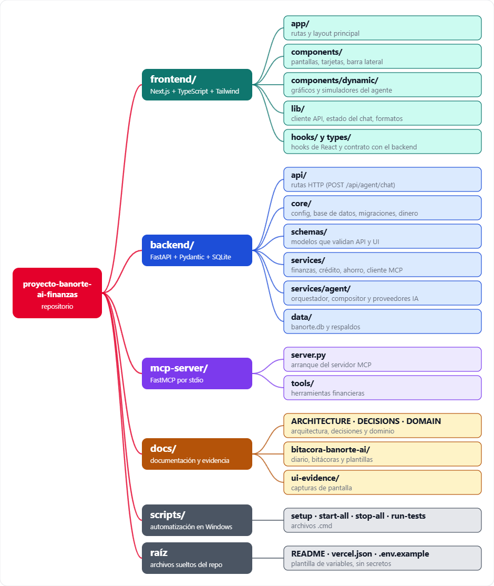

# Estructura del proyecto

Organización de carpetas y archivos principales. Se excluyen `node_modules`, `.next`, `.venv`, `__pycache__`, `.git`, `.env` y archivos con claves o secretos.

## Para qué sirve cada carpeta

| Carpeta | Propósito |
| --- | --- |
| `frontend/` | Aplicación web en Next.js 15 + TypeScript + Tailwind. Contiene la UI conversacional y los componentes dinámicos que el agente renderiza. |
| `frontend/src/app/` | Rutas y layout principal de Next.js (`page.tsx`, `layout.tsx`, estilos globales). |
| `frontend/src/components/` | Componentes de interfaz reutilizables (shell, barra superior, sidebar, vistas, tarjetas, animaciones). |
| `frontend/src/components/dynamic/` | Registro de componentes autorizados que el contrato JSON del agente puede renderizar (gráficos, tablas, simuladores, formularios). |
| `frontend/src/lib/` | Lógica del cliente: cliente HTTP, estado del chat, formato de montos, navegación y seguridad del chat. |
| `frontend/src/hooks/` | Hooks personalizados de React (por ejemplo, respeto a movimiento reducido). |
| `frontend/src/types/` | Tipos TypeScript del contrato entre frontend y backend. |
| `frontend/tests/` | Pruebas de la experiencia del asistente y de seguridad del chat. |
| `backend/` | API en FastAPI + Pydantic + SQLite. Orquesta el agente, valida el contrato y expone los endpoints. |
| `backend/app/api/` | Definición de rutas HTTP (incluye `POST /api/agent/chat`). |
| `backend/app/core/` | Infraestructura: configuración, base de datos, migraciones, manejo de dinero, reconciliación, seed y logging estructurado. |
| `backend/app/schemas/` | Modelos Pydantic que validan las respuestas de la API y el contrato de UI. |
| `backend/app/services/` | Lógica de negocio financiera (finanzas, crédito, ahorro, dominio) y cliente MCP. |
| `backend/app/services/agent/` | Núcleo del agente: orquestador, compositor determinista de UI y proveedores de IA. |
| `backend/data/` | Base SQLite sintética (`banorte.db`) y respaldos automáticos. |
| `backend/tests/` | Suite de pytest: cálculos, contrato UI, servicios, MCP, seguridad y migraciones. |
| `mcp-server/` | Servidor MCP independiente (FastMCP, transporte stdio) con las herramientas financieras que consume el backend. |
| `mcp-server/tools/` | Implementación de las herramientas financieras expuestas por MCP. |
| `docs/` | Documentación de arquitectura, decisiones, dominio, diccionario de datos, estado del proyecto y QA. |
| `docs/bitacora-banorte-ai/` | Bitácoras de trabajo, diario y plantillas del proyecto. |
| `docs/ui-evidence/` | Capturas de pantalla que evidencian la interfaz en distintos tamaños. |
| `scripts/` | Scripts `.cmd` para instalar, arrancar, detener y ejecutar pruebas en Windows. |
| `.github/skills/archify/` | Skill/herramienta de apoyo para generar diagramas de arquitectura. |
| `frontend/ui-evidence/` | Evidencia visual adicional del frontend. |
| `.archify/` | Artefactos generados por la herramienta de arquitectura (no forma parte del código de la app). |
